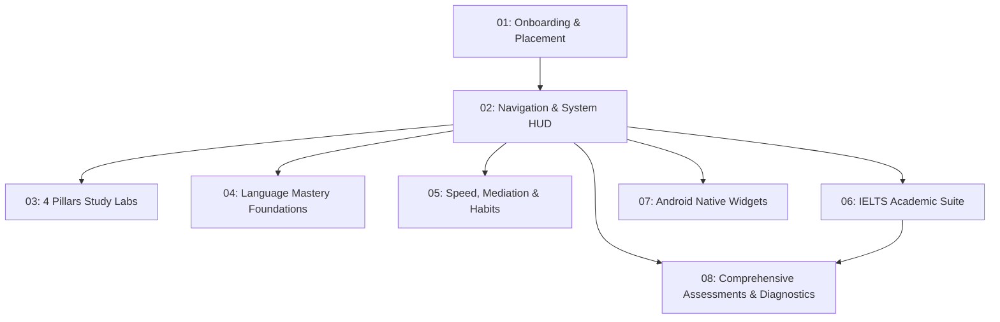

# Mobile Application Visual Flow Catalog & Audit

> **Device Specifications:** Mobile Viewport 390 × 844 px (iPhone 14/15, DPR 2.0)  
> **Localization:** Fully Bilingual with Active Vietnamese UI Verification  
> **Total Flow Artifacts:** 147 Scrolled Viewport Captures across 8 User Flows & Assessment Suites  

---

## Architecture of Flows

---

## 01. Onboarding & Placement Quiz (`01-onboarding-placement/`)

Captures the student onboarding journey from diagnostic placement through interactive spotlight introduction and final level calibration.

| Step | Viewport State | Screenshot Path | Description |
| :--- | :--- | :--- | :--- |
| **01. Intro** | Top View | [`01-placement-intro-01-top.png`](./01-onboarding-placement/01-placement-intro-01-top.png) | 2-minute diagnostic intro modal with CEFR level calibration promise. |
| **02. Question** | Top View | [`02-placement-question-01-top.png`](./01-onboarding-placement/02-placement-question-01-top.png) | Single-choice adaptive diagnostic question with clean option cards. |
| **03. Tour** | Top View | [`03-spotlight-tour-01-top.png`](./01-onboarding-placement/03-spotlight-tour-01-top.png) | Interactive Spotlight Game Tour highlighting HUD telemetry clusters. |
| **04. Placement Result** | Top View | [`04-placement-result-01-top.png`](./01-onboarding-placement/04-placement-result-01-top.png) | Final CEFR level calibration receipt ("YOUR LEVEL: B2 Vantage") with level selector. |

---

## 02. Navigation, Telemetry & System HUD (`02-navigation-hud/`)

Captures the core navigation systems, settings, progression hubs, and mistake tracking.

| Component | State | Screenshot Path | Highlights |
| :--- | :--- | :--- | :--- |
| **01. Constellation** | Top | [`01-constellation-deck-01-top.png`](./02-navigation-hud/01-constellation-deck-01-top.png) | Mobile Skill Deck view with 5 branch cards and progress bars. |
| **02. Urchin Canvas** | Top | [`02-living-canvas-01-top.png`](./02-navigation-hud/02-living-canvas-01-top.png) | Living Sea Urchin 2.5D perspective canvas. |
| **03. Mobile Drawer** | Top | [`03-mobile-drawer-01-top.png`](./02-navigation-hud/03-mobile-drawer-01-top.png) | Quick action sheet with immediate **EN / VI** language toggle button. |
| **04. Settings Modal** | Top | [`04-settings-modal-01-top.png`](./02-navigation-hud/04-settings-modal-01-top.png) | Language Segmented Control (`English` / `Tiếng Việt`) & Reset actions. |
| | Scrolled | [`04-settings-modal-02-scrolled.png`](./02-navigation-hud/04-settings-modal-02-scrolled.png) | Dual audio sliders (SFX & Music volume) and Soundscape selector. |
| | Bottom | [`04-settings-modal-03-bottom.png`](./02-navigation-hud/04-settings-modal-03-bottom.png) | Motion toggle and backup export/import controls. |
| **05. Settings Dossier** | Top | [`05-settings-dossier-01-top.png`](./02-navigation-hud/05-settings-dossier-01-top.png) | Full 6-Card Architecture: CEFR Profile, Daily XP Goal. |
| | Scrolled | [`05-settings-dossier-02-scrolled.png`](./02-navigation-hud/05-settings-dossier-02-scrolled.png) | Card 02 Appearance (Language Switcher) and Card 03 Audio Engine. |
| | Bottom | [`05-settings-dossier-03-bottom.png`](./02-navigation-hud/05-settings-dossier-03-bottom.png) | Card 04 Notifications, Card 05 Storage, and Card 06 System Info. |
| **06a. Multi-Skill Intro** | Top | [`06b-multiskill-assessment-intro-01-top.png`](./02-navigation-hud/06b-multiskill-assessment-intro-01-top.png) | Multi-Skill CEFR Assessment Intro ("Calibrate Your Language Proficiency"). |
| | Scrolled | [`06b-multiskill-assessment-intro-02-scrolled.png`](./02-navigation-hud/06b-multiskill-assessment-intro-02-scrolled.png) | 5-Stage Skill Stepper (Vocab, Grammar, Reading, Listening, Writing). |
| | Bottom | [`06b-multiskill-assessment-intro-03-bottom.png`](./02-navigation-hud/06b-multiskill-assessment-intro-03-bottom.png) | Action CTAs (Start Diagnostic vs View Current Radar). |
| **06b. Multi-Skill Question**| Top | [`06c-multiskill-assessment-question-01-top.png`](./02-navigation-hud/06c-multiskill-assessment-question-01-top.png) | Adaptive diagnostic question with 5-stage progress indicator. |
| | Scrolled | [`06c-multiskill-assessment-question-02-scrolled.png`](./02-navigation-hud/06c-multiskill-assessment-question-02-scrolled.png) | Question stimulus, option buttons, and keyboard hotkeys. |
| | Bottom | [`06c-multiskill-assessment-question-03-bottom.png`](./02-navigation-hud/06c-multiskill-assessment-question-03-bottom.png) | Assessment cancel & keep current levels action button. |
| **06c. Celestial Radar** | Top | [`06-celestial-radar-01-top.png`](./02-navigation-hud/06-celestial-radar-01-top.png) | 5-Axis Multi-Skill CEFR spider radar polygon. |
| | Scrolled | [`06-celestial-radar-02-scrolled.png`](./02-navigation-hud/06-celestial-radar-02-scrolled.png) | Skill level breakdown badges (Reading, Writing, Listening, etc.). |
| | Bottom | [`06-celestial-radar-03-bottom.png`](./02-navigation-hud/06-celestial-radar-03-bottom.png) | Diagnostic recalibration action buttons. |
| **07. RPG Progression** | Top | [`07-rpg-progression-01-top.png`](./02-navigation-hud/07-rpg-progression-01-top.png) | Daily Quests (1/3 Completed), XP level progress bar. |
| | Scrolled | [`07-rpg-progression-02-scrolled.png`](./02-navigation-hud/07-rpg-progression-02-scrolled.png) | Quest cards (SRS Review, Copywork, Examiner Simulation). |
| | Bottom | [`07-rpg-progression-03-bottom.png`](./02-navigation-hud/07-rpg-progression-03-bottom.png) | Milestone badges and achievement trophies. |
| **08. Mistake Vault** | Top | [`08-mistake-vault-01-top.png`](./02-navigation-hud/08-mistake-vault-01-top.png) | Active defect archive and category breakdown filter pills. |
| | Scrolled | [`08-mistake-vault-02-scrolled.png`](./02-navigation-hud/08-mistake-vault-02-scrolled.png) | Mistake cards with original error vs corrected solution diff. |
| | Bottom | [`08-mistake-vault-03-bottom.png`](./02-navigation-hud/08-mistake-vault-03-bottom.png) | Clear defects action and SM-2 retry scheduling. |
| **09. Star Map Canvas** | Top | [`09-star-map-canvas-01-top.png`](./02-navigation-hud/09-star-map-canvas-01-top.png) | Interactive 2.5D SVG Star Map constellation canvas. |
| **10. Skill Node Modal** | Top | [`10-skill-node-modal-01-top.png`](./02-navigation-hud/10-skill-node-modal-01-top.png) | Node perk detail modal with dependencies and mastery level. |
| **11. Corner Compass** | Top | [`11-corner-compass-01-top.png`](./02-navigation-hud/11-corner-compass-01-top.png) | Radial Corner Compass floating navigation hub. |
| | Scrolled | [`11-corner-compass-02-scrolled.png`](./02-navigation-hud/11-corner-compass-02-scrolled.png) | Radial action nodes list for instant jumps across all 10 modules. |
| | Bottom | [`11-corner-compass-03-bottom.png`](./02-navigation-hud/11-corner-compass-03-bottom.png) | Workspace overlay alignment and close trigger. |
| **12. Commute Audio Player** | Top | [`12-commute-player-01-top.png`](./02-navigation-hud/12-commute-player-01-top.png) | Autonomous Hands-Free Walking & Commute Audio Loop sheet. |
| | Scrolled | [`12-commute-player-02-scrolled.png`](./02-navigation-hud/12-commute-player-02-scrolled.png) | Active recall audio prompt, answer delay rate, and speech rate. |
| | Bottom | [`12-commute-player-03-bottom.png`](./02-navigation-hud/12-commute-player-03-bottom.png) | Media session controls and auto-pause safeguards. |

---

## 03. Four Pillars Study Workbenches (`03-four-pillars/`)

Captures the core learning laboratories across Reading, Writing, Listening, and Speaking.

| Laboratory | Stage | Screenshot Path | Highlights |
| :--- | :--- | :--- | :--- |
| **Reading Lab** | Pass 1 Top | [`01-reading-pass1-01-top.png`](./03-four-pillars/01-reading-pass1-01-top.png) | 4-Pass Stepper header with article metadata. |
| | Pass 1 Scrolled | [`01-reading-pass1-02-scrolled.png`](./03-four-pillars/01-reading-pass1-02-scrolled.png) | Skim reading passage with clickable vocabulary targets. |
| | Pass 1 Bottom | [`01-reading-pass1-03-bottom.png`](./03-four-pillars/01-reading-pass1-03-bottom.png) | Bottom pass navigation dock and next pass trigger. |
| | Zen Mode Top | [`02-reading-zen-01-top.png`](./03-four-pillars/02-reading-zen-01-top.png) | Zen Immersion Mode: HUD chrome stripped for deep focus. |
| | Zen Mode Scrolled | [`02-reading-zen-02-scrolled.png`](./03-four-pillars/02-reading-zen-02-scrolled.png) | Continuous undisturbed reading text with balanced line length. |
| | Zen Mode Bottom | [`02-reading-zen-03-bottom.png`](./03-four-pillars/02-reading-zen-03-bottom.png) | Bottom exit Zen indicator. |
| **Writing Studio** | Step 1 Top | [`03-writing-scaffold-01-top.png`](./03-four-pillars/03-writing-scaffold-01-top.png) | Step 1: Structural syntax scaffolding breakdown. |
| | Step 1 Scrolled | [`03-writing-scaffold-02-scrolled.png`](./03-four-pillars/03-writing-scaffold-02-scrolled.png) | Morphological clauses, SVO blocks, and proceed CTA. |
| | Step 2 (Typing) | [`04-writing-type-01-top.png`](./03-four-pillars/04-writing-type-01-top.png) | Step 2: Active recall typing input with auto-zoom prevention. |
| | Step 3 (Diff) Top | [`05-writing-diff-01-top.png`](./03-four-pillars/05-writing-diff-01-top.png) | Step 3: Real-time Myers split-diff evaluation with match %. |
| | Step 3 (Diff) Scrolled | [`05-writing-diff-02-scrolled.png`](./03-four-pillars/05-writing-diff-02-scrolled.png) | Word-by-word token diff analysis and SRS rating dock. |
| **Listening Chamber** | Top | [`06-listening-chamber-01-top.png`](./03-four-pillars/06-listening-chamber-01-top.png) | Speech synthesizer controls, audio speed, phonetic cloze prompt. |
| **Speaking Studio** | Top | [`07-speaking-studio-01-top.png`](./03-four-pillars/07-speaking-studio-01-top.png) | Dual oscilloscope display, Nation 4-3-2 cadence timer. |
| | Scrolled | [`07-speaking-studio-02-scrolled.png`](./03-four-pillars/07-speaking-studio-02-scrolled.png) | Mic input trigger, speech evaluation feedback, transcript box. |

---

## 04. Language Mastery Foundations (`04-mastery-foundations/`)

Captures vocabulary vaults, collocations forge, 12 verb tenses, grammar, Cambridge drills, sounds chart, email builder, and in-text lexicon dictionary.

| Module | State | Screenshot Path | Highlights |
| :--- | :--- | :--- | :--- |
| **Vocab Vault** | Front Face | [`01-vocab-front-01-top.png`](./04-mastery-foundations/01-vocab-front-01-top.png) | Atomic Card Front Face with prompt sentence, audio button, flip CTA. |
| | Flipped Back Face | [`02-vocab-back-01-top.png`](./04-mastery-foundations/02-vocab-back-01-top.png) | Resolution Face with IPA, Vietnamese definition, and SM-2 rating dock. |
| **Collocations** | Drill Mode | [`03-collocations-drill-01-top.png`](./04-mastery-foundations/03-collocations-drill-01-top.png) | SRS flashcard mode for chunk collocations. |
| | Lexicon Table Top | [`04-collocations-lexicon-01-top.png`](./04-mastery-foundations/04-collocations-lexicon-01-top.png) | 1,000 Searchable Table mode with instant English/Vietnamese filter. |
| | Lexicon Table Scrolled | [`04-collocations-lexicon-02-scrolled.png`](./04-mastery-foundations/04-collocations-lexicon-02-scrolled.png) | Table rows with audio button, Vietnamese meaning, and pagination bar. |
| **Grammar Codex** | Top | [`05-grammar-codex-01-top.png`](./04-mastery-foundations/05-grammar-codex-01-top.png) | Syntax transformation console with input and verify button. |
| | Scrolled | [`05-grammar-codex-02-scrolled.png`](./04-mastery-foundations/05-grammar-codex-02-scrolled.png) | Inline diff feedback and rule explanation. |
| **12 Verb Tenses** | Random Drill Top | [`06-tenses-drill-01-top.png`](./04-mastery-foundations/06-tenses-drill-01-top.png) | Multiple-choice tense identification with Vietnamese context hints. |
| | Random Drill Scrolled | [`06-tenses-drill-02-scrolled.png`](./04-mastery-foundations/06-tenses-drill-02-scrolled.png) | Sentence stimulus, option pills, and instant answer verification. |
| | Codex Cards Top | [`07-tenses-codex-01-top.png`](./04-mastery-foundations/07-tenses-codex-01-top.png) | Formula boxes, timeline diagrams, and authentic exemplars. |
| | Codex Cards Scrolled | [`07-tenses-codex-02-scrolled.png`](./04-mastery-foundations/07-tenses-codex-02-scrolled.png) | Aspect families breakdown (Simple, Continuous, Perfect, Perfect Continuous). |
| | Codex Cards Bottom | [`07-tenses-codex-03-bottom.png`](./04-mastery-foundations/07-tenses-codex-03-bottom.png) | Deep morphological patterns and irregular verb exemplars. |
| | Gauntlet Question | [`08-tenses-gauntlet-01-top.png`](./04-mastery-foundations/08-tenses-gauntlet-01-top.png) | Rapid 12-tense conjugation sprint question workbench. |
| | **Gauntlet Scorecard** | [`08b-tenses-gauntlet-scorecard-01-top.png`](./04-mastery-foundations/08b-tenses-gauntlet-scorecard-01-top.png) | **12-Tense Gauntlet Diagnostic Receipt & Scorecard** with 12-tense matrix grid. |
| **Lexicon Drawer** | Top | [`09-lexicon-drawer-01-top.png`](./04-mastery-foundations/09-lexicon-drawer-01-top.png) | Universal sliding drawer with IPA, etymology root, and Vietnamese translation. |
| **Cambridge Drills** | Top | [`10-cambridge-drills-01-top.png`](./04-mastery-foundations/10-cambridge-drills-01-top.png) | 36 Cambridge-style practice sets across 6 core skills with skill filter chips. |
| | Scrolled | [`10-cambridge-drills-02-scrolled.png`](./04-mastery-foundations/10-cambridge-drills-02-scrolled.png) | Exercise set cards with objectives, duration, and Start triggers. |
| **Phonemic Sounds** | Top | [`11-phonemic-sounds-01-top.png`](./04-mastery-foundations/11-phonemic-sounds-01-top.png) | Interactive IPA phonemic chart with monophthongs, diphthongs, and consonants. |
| **Email Builder** | Top | [`12-email-builder-01-top.png`](./04-mastery-foundations/12-email-builder-01-top.png) | Business email paragraph builder with authentic workplace communication templates. |
| | Scrolled | [`12-email-builder-02-scrolled.png`](./04-mastery-foundations/12-email-builder-02-scrolled.png) | Opening formulas, request phrasing, closing statements, and 1-click copy action. |

---

## 05. Speed Blitz, Mediation & Exam Cockpit (`05-speed-mediation-habits/`)

Captures high-intensity gamified modes, CEFR mediation, daily habit tracking, and full exam cockpits.

| Module | State | Screenshot Path | Highlights |
| :--- | :--- | :--- | :--- |
| **Speed Blitz** | Top | [`01-speed-blitz-01-top.png`](./05-speed-mediation-habits/01-speed-blitz-01-top.png) | 60-Second Roguelike Speed Blitz with combo multiplier. |
| **Mediation** | Top | [`02-mediation-workbench-01-top.png`](./05-speed-mediation-habits/02-mediation-workbench-01-top.png) | CEFR Mediation: Cross-linguistic summary and paraphrase workshop. |
| **Mission Log** | Top | [`03-mission-log-01-top.png`](./05-speed-mediation-habits/03-mission-log-01-top.png) | Daily habit checklist, routine streaks, and completion stamps. |
| | Scrolled | [`03-mission-log-02-scrolled.png`](./05-speed-mediation-habits/03-mission-log-02-scrolled.png) | 30-day mission streak calendar and daily XP milestones. |
| **Analytics & SERL** | Top | [`04-analytics-serl-01-top.png`](./05-speed-mediation-habits/04-analytics-serl-01-top.png) | CEFR Mastery breakdown, retention curves, and study time graph. |
| | Scrolled | [`04-analytics-serl-02-scrolled.png`](./05-speed-mediation-habits/04-analytics-serl-02-scrolled.png) | SERL 2.0 Gauntlet skill proficiency matrices. |
| **Exam Cockpit (Reading)** | Top | [`05-exam-cockpit-reading-01-top.png`](./05-speed-mediation-habits/05-exam-cockpit-reading-01-top.png) | Split Reading Passage with 1-40 Question Gap-Fill Navigator. |
| **Exam Cockpit (Writing)** | Top | [`06-exam-cockpit-writing-01-top.png`](./05-speed-mediation-habits/06-exam-cockpit-writing-01-top.png) | Task 1 & Task 2 live essay composer with live word counter. |
| **Band Score Modal** | Top | [`07-exam-cockpit-band-modal-01-top.png`](./05-speed-mediation-habits/07-exam-cockpit-band-modal-01-top.png) | **Official CD-IELTS 40-Question Band Conversion Report Modal** with needle gauge. |

---

## 06. IELTS Academic Suite (`06-ielts-academic/`)

Captures the comprehensive IELTS Academic preparation suite with offline scoring engines and subnav studios.

| View | State | Screenshot Path | Highlights |
| :--- | :--- | :--- | :--- |
| **01. Overview** | Top | [`01-ielts-overview-01-top.png`](./06-ielts-academic/01-ielts-overview-01-top.png) | Road to 7.0 Overview with Executive Top Bar and Language Switcher. |
| | Scrolled | [`01-ielts-overview-02-scrolled.png`](./06-ielts-academic/01-ielts-overview-02-scrolled.png) | Four skill suites cards with band score targets. |
| | Bottom | [`01-ielts-overview-03-bottom.png`](./06-ielts-academic/01-ielts-overview-03-bottom.png) | Official band score conversion table and diagnostic report. |
| **01b. Band Report** | Top | [`01b-ielts-band-readiness-report-01-top.png`](./06-ielts-academic/01b-ielts-band-readiness-report-01-top.png) | **Official 4-Skill Band Score Report & 7.0 Readiness Gate** checklist. |
| **02. Diagnostic (Questions)**| Top | [`02-ielts-diagnostic-01-top.png`](./06-ielts-academic/02-ielts-diagnostic-01-top.png) | 4-Skill diagnostic test launcher and estimated band indicators. |
| | Scrolled | [`02-ielts-diagnostic-02-scrolled.png`](./06-ielts-academic/02-ielts-diagnostic-02-scrolled.png) | Skill diagnostic question cards with audio playback. |
| | Bottom | [`02-ielts-diagnostic-03-bottom.png`](./06-ielts-academic/02-ielts-diagnostic-03-bottom.png) | Submit diagnostic assessment action button. |
| **02b. Diagnostic Report** | Top | [`02b-ielts-diagnostic-taxonomy-report-01-top.png`](./06-ielts-academic/02b-ielts-diagnostic-taxonomy-report-01-top.png) | **6-Vector Error Taxonomy Diagnostic Report** (Band 7.5+ baseline & prescriptions). |
| | Scrolled | [`02b-ielts-diagnostic-taxonomy-report-02-scrolled.png`](./06-ielts-academic/02b-ielts-diagnostic-taxonomy-report-02-scrolled.png) | Granular vector cards (Subject-Verb, Tenses, Articles, Clauses, Collocations). |
| | Bottom | [`02b-ielts-diagnostic-taxonomy-report-03-bottom.png`](./06-ielts-academic/02b-ielts-diagnostic-taxonomy-report-03-bottom.png) | Band Descriptor Rubric Impact analysis and targeted study action plan. |
| **03. Reading (Timed)** | Top | [`03-ielts-reading-timed-01-top.png`](./06-ielts-academic/03-ielts-reading-timed-01-top.png) | Timed Passage view with countdown timer and subnav bar. |
| | Scrolled | [`03-ielts-reading-timed-02-scrolled.png`](./06-ielts-academic/03-ielts-reading-timed-02-scrolled.png) | Academic reading text with paragraph markers (A-G). |
| | Bottom | [`03-ielts-reading-timed-03-bottom.png`](./06-ielts-academic/03-ielts-reading-timed-03-bottom.png) | Question items (T/F/NG, Matching headings, Summary completion). |
| **03b. Reading Result** | Top | [`03b-ielts-reading-test-result-01-top.png`](./06-ielts-academic/03b-ielts-reading-test-result-01-top.png) | **Reading Test Calibrated Band Scorecard Result** with question type breakdown. |
| **04. Reading (Drills)** | Top | [`04-ielts-reading-attack-drills-01-top.png`](./06-ielts-academic/04-ielts-reading-attack-drills-01-top.png) | 14 Attack Drills Studio selector. |
| | Scrolled | [`04-ielts-reading-attack-drills-02-scrolled.png`](./06-ielts-academic/04-ielts-reading-attack-drills-02-scrolled.png) | Drill cards with targeted passage excerpt and instant check. |
| | Bottom | [`04-ielts-reading-attack-drills-03-bottom.png`](./06-ielts-academic/04-ielts-reading-attack-drills-03-bottom.png) | Detailed evidence line explanation (*why* citation). |
| **05. Listening (Audio)** | Top | [`05-ielts-listening-audio-01-top.png`](./06-ielts-academic/05-ielts-listening-audio-01-top.png) | Sections 1-4 audio player with playback speed and scrubber. |
| | Scrolled | [`05-ielts-listening-audio-02-scrolled.png`](./06-ielts-academic/05-ielts-listening-audio-02-scrolled.png) | Listening form-filling questions and answer inputs. |
| | Bottom | [`05-ielts-listening-audio-03-bottom.png`](./06-ielts-academic/05-ielts-listening-audio-03-bottom.png) | Submit section answers and score conversion report. |
| **05b. Listening Result** | Top | [`05b-ielts-listening-test-result-01-top.png`](./06-ielts-academic/05b-ielts-listening-test-result-01-top.png) | **Listening Test Calibrated Band Scorecard Result** with full script evidence. |
| **06. Listening (Traps)** | Top | [`06-ielts-listening-traps-01-top.png`](./06-ielts-academic/06-ielts-listening-traps-01-top.png) | Acoustic self-correction traps and decoy detection lab. |
| | Scrolled | [`06-ielts-listening-traps-02-scrolled.png`](./06-ielts-academic/06-ielts-listening-traps-02-scrolled.png) | Trap scenarios (reversals, qualifiers, self-corrections). |
| **07. Writing (Prompts)** | Top | [`07-ielts-writing-prompts-01-top.png`](./06-ielts-academic/07-ielts-writing-prompts-01-top.png) | Task 1 & Task 2 prompts with 4 official IELTS assessment criteria. |
| | Scrolled | [`07-ielts-writing-prompts-02-scrolled.png`](./06-ielts-academic/07-ielts-writing-prompts-02-scrolled.png) | Task 1 sample graphs, model answers (Band 7.0 vs Band 9.0). |
| | Bottom | [`07-ielts-writing-prompts-03-bottom.png`](./06-ielts-academic/07-ielts-writing-prompts-03-bottom.png) | Rubric criteria breakdown (TR, CC, LR, GRA). |
| **08. Writing (Studio)** | Top | [`08-ielts-writing-blueprints-01-top.png`](./06-ielts-academic/08-ielts-writing-blueprints-01-top.png) | Paragraph Architect & essay blueprints generator. |
| | Scrolled | [`08-ielts-writing-blueprints-02-scrolled.png`](./06-ielts-academic/08-ielts-writing-blueprints-02-scrolled.png) | Introduction, Overview, and Body paragraph structures. |
| | Bottom | [`08-ielts-writing-blueprints-03-bottom.png`](./06-ielts-academic/08-ielts-writing-blueprints-03-bottom.png) | Cohesion linking phrases and band 8+ sentence builders. |
| **09. Speaking (Prompts)** | Top | [`09-ielts-speaking-prompts-01-top.png`](./06-ielts-academic/09-ielts-speaking-prompts-01-top.png) | Cue Cards and scratchpad notepad for 1-minute prep time. |
| **10. Speaking (Sim)** | Top | [`10-ielts-speaking-simulator-01-top.png`](./06-ielts-academic/10-ielts-speaking-simulator-01-top.png) | AI Examiner Simulator with authentic test prompts. |
| | Scrolled | [`10-ielts-speaking-simulator-02-scrolled.png`](./06-ielts-academic/10-ielts-speaking-simulator-02-scrolled.png) | Examiner speech playback, recording response, fluency analysis. |
| **10b. Speaking Assessment**| Top | [`10b-ielts-speaking-assessment-feedback-01-top.png`](./06-ielts-academic/10b-ielts-speaking-assessment-feedback-01-top.png) | **Speaking Simulator 4-Criteria Assessment Feedback** (Band 8.0+ Badge & Fillers). |
| | Scrolled | [`10b-ielts-speaking-assessment-feedback-02-scrolled.png`](./06-ielts-academic/10b-ielts-speaking-assessment-feedback-02-scrolled.png) | Granular breakdown across Fluency & Coherence, Lexical Resource, GRA, Pronunciation. |
| **11. Vocab Lexicon** | Top | [`11-ielts-vocab-lexicon-01-top.png`](./06-ielts-academic/11-ielts-vocab-lexicon-01-top.png) | Academic topic lexicon by theme (*Environment, Technology, Education*). |
| **12. Strategy Codex** | Top | [`12-ielts-strategy-codex-01-top.png`](./06-ielts-academic/12-ielts-strategy-codex-01-top.png) | 46 Master Strategy Cards categorized by skill and difficulty. |
| | Scrolled | [`12-ielts-strategy-codex-02-scrolled.png`](./06-ielts-academic/12-ielts-strategy-codex-02-scrolled.png) | Strategy cards with actionable examination techniques. |
| | Bottom | [`12-ielts-strategy-codex-03-bottom.png`](./06-ielts-academic/12-ielts-strategy-codex-03-bottom.png) | Time allocation blueprints and examination checklist. |
| **13. Mock Exam** | Top | [`13-ielts-mock-exam-01-top.png`](./06-ielts-academic/13-ielts-mock-exam-01-top.png) | Full offline mock exam simulation cockpit (Reading & Listening). |
| | Scrolled | [`13-ielts-mock-exam-02-scrolled.png`](./06-ielts-academic/13-ielts-mock-exam-02-scrolled.png) | Timed question sheet with auto-save state. |
| | Bottom | [`13-ielts-mock-exam-03-bottom.png`](./06-ielts-academic/13-ielts-mock-exam-03-bottom.png) | Test submission action and raw-to-band conversion score. |
| **14. Study Path** | Top | [`14-ielts-study-path-01-top.png`](./06-ielts-academic/14-ielts-study-path-01-top.png) | Guided 7.0 Study Path with 4-Skill Readiness Gate verification cards. |
| **15. Strategy Guide Modal** | Top | [`15-ielts-strategy-modal-01-top.png`](./06-ielts-academic/15-ielts-strategy-modal-01-top.png) | Detailed tactical strategy guide modal dialog with audio player and action steps. |
| | Scrolled | [`15-ielts-strategy-modal-02-scrolled.png`](./06-ielts-academic/15-ielts-strategy-modal-02-scrolled.png) | Deep tactical takeaways, model examples, and step-by-step examination tactics. |
| | Bottom | [`15-ielts-strategy-modal-03-bottom.png`](./06-ielts-academic/15-ielts-strategy-modal-03-bottom.png) | Examiner notes and modal close action button. |

---

## 07. Android Home Screen Widgets (`07-android-widgets/`)

Captures the native Android home screen widget across Compact, Standard, and Tabbed Expanded layouts.

| Widget Variant | Screenshot Path | Highlights |
| :--- | :--- | :--- |
| **All Widget Sizes** | [`01-widget-showcase-all-sizes.png`](./07-android-widgets/01-widget-showcase-all-sizes.png) | Comprehensive showcase of Compact ($2\times 1$), Standard ($3\times 2$), and Expanded ($4\times 3$) tabbed widgets showing daily streak, bilingual vocabulary cards, daily quests, and 4 core pillars. |

---

## 08. Comprehensive Assessments & Diagnostics Suite (`08-assessments-diagnostics/`)

Curated standalone catalog containing all 11 standardized assessment scorecards, diagnostic receipts, and band score evaluation reports across the entire platform.

| Assessment Suite | Screenshot Path | Evaluated Competencies & Rubrics |
| :--- | :--- | :--- |
| **01. CEFR Placement Level Calibration** | [`01-cefr-placement-assessment-result.png`](./08-assessments-diagnostics/01-cefr-placement-assessment-result.png) | 24-question adaptive placement result allocating learner level ($A1 \to C2$), pass-mark thresholding, and level selection options. |
| **02. Multi-Skill CEFR Diagnostic Intro** | [`02-multiskill-diagnostic-intro.png`](./08-assessments-diagnostics/02-multiskill-diagnostic-intro.png) | 5-stage diagnostic launcher tracking Vocabulary, Grammar, Reading, Listening, and Writing stages with 15-question roadmap. |
| **03. Multi-Skill CEFR Diagnostic Question** | [`03-multiskill-diagnostic-question.png`](./08-assessments-diagnostics/03-multiskill-diagnostic-question.png) | Active adaptive diagnostic question item with stage stepper, audio pronunciation, and hotkey response cards. |
| **04. Multi-Skill CEFR Celestial Radar** | [`04-multiskill-celestial-radar-report.png`](./08-assessments-diagnostics/04-multiskill-celestial-radar-report.png) | 5-axis spider radar assessment report comparing asymmetry across language competencies and recalibration triggers. |
| **05. 12-Tense Gauntlet Diagnostic Receipt** | [`05-tenses-gauntlet-diagnostic-receipt.png`](./08-assessments-diagnostics/05-tenses-gauntlet-diagnostic-receipt.png) | Complete 12-aspect conjugation scorecard ($11/12$, $92\%$), CEFR mastery verdict (`C1/C2 NATIVE TENSE MASTERY`), and matrix grid. |
| **06. IELTS 6-Vector Error Taxonomy Report** | [`06-ielts-diagnostic-taxonomy-report.png`](./08-assessments-diagnostics/06-ielts-diagnostic-taxonomy-report.png) | Full academic diagnostic report with estimated band ($7.5+$), 6 error vectors (Subject-Verb, Tenses, Articles, Clauses, Collocations), and GRA/LR rubrics. |
| **07. IELTS 4-Skill Band & Readiness Report** | [`07-ielts-band-readiness-report.png`](./08-assessments-diagnostics/07-ielts-band-readiness-report.png) | Official 4-skill conversion report (L: $7.0$, R: $7.5$, W: $7.0$, S: $7.5$, Overall: $7.5$) and 7.0 Readiness Gate checklist. |
| **08. IELTS Reading Band Scorecard** | [`08-ielts-reading-band-scorecard.png`](./08-assessments-diagnostics/08-ielts-reading-band-scorecard.png) | Test submission scorecard with calibrated Band 7.5 badge, raw-to-band scaling, and question-type accuracy breakdown. |
| **09. IELTS Listening Band Scorecard** | [`09-ielts-listening-band-scorecard.png`](./08-assessments-diagnostics/09-ielts-listening-band-scorecard.png) | Test submission scorecard with calibrated Band 7.0 badge, question breakdown, and transcript evidence replay line anchors. |
| **10. IELTS Speaking 4-Criteria Assessment** | [`10-ielts-speaking-4criteria-assessment.png`](./08-assessments-diagnostics/10-ielts-speaking-4criteria-assessment.png) | Real-time examiner simulator evaluation: Band 8.0+ badge, native conversational filler counter, and FC/LR/GRA/PR scores. |
| **11. CD-IELTS 40-Q Exam Cockpit Band Modal** | [`11-ielts-exam-cockpit-band-modal.png`](./08-assessments-diagnostics/11-ielts-exam-cockpit-band-modal.png) | Official computerized exam band conversion modal with $0.0 \to 9.0$ needle gauge ($83\%$, Band $7.5$) and review triggers. |
