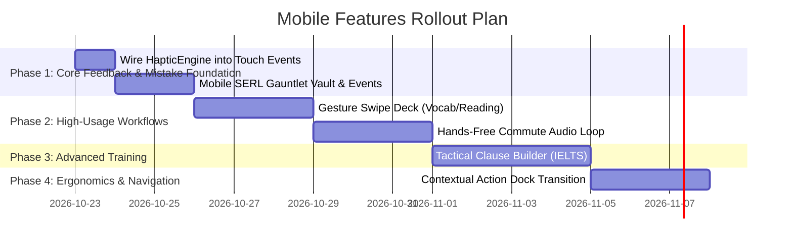

# Mobile Feature Proposals — English Singularity & IELTS Mobile

> **Status:** Proposed Concept & Architectural Blueprint  
> **Date:** 2026-10-22  
> **Design Philosophy:** 100% Client-Side, Zero External APIs, Thumb-Ergonomic, Touch Target ≥ 44px, 390px Mobile Viewport Optimized.

---

## Executive Summary

This document details high-impact, mobile-first features designed to transform the desktop-adapted views into a tactile, ergonomic phone learning experience. All proposals build upon existing core engines (`HapticEngine`, `SerlGauntletEngine`, `SRSEngine`, Web Audio) without adding new external dependencies or breaking desktop workflows.

| # | Proposal | App | Technical Dependency | Complexity |
|---|---|---|---|:---:|
| 1 | Gesture-Driven Swipe Deck | Singularity | PointerEvents + CSS Touch Actions + `HapticEngine` | Low |
| 2 | Hands-Free Commute Audio Loop | Both | Web Speech Synthesis + MediaSession API + Web Audio | Medium |
| 3 | Cross-Dossier Smart Mistake Vault | Both | `SerlGauntletEngine` + LocalStorage + Event Bus | Low |
| 4 | Tactical Clause Builder | IELTS | Flexbox Tap Tokens + `writing-heuristics.ts` | Medium |
| 5 | Tactile Haptic Sensory Tuning | Both | `web/src/core/haptic-engine.ts` (Android Vibration API) | Very Low |
| 6 | One-Thumb Contextual Action Dock | Singularity | Contextual Bottom Dock (`--safe-bottom-dock`) | Medium |

**App column definitions:**
* **Singularity:** Main app (`web/index.html`, `web/src/modules/`).
* **IELTS:** IELTS suite (`web/ielts.html`, `web/src/ielts/`).
* **Both:** Shared utilities in `web/src/core/` consumed by both applications.

---

## 1. Gesture-Driven Swipe Deck (SRS Vocab, Collocations & Reading Mining)

**App:** Singularity — gesture layer added to [`core/atomic-card.ts`](file:///e:/Eng/web/src/core/atomic-card.ts), which is the single flashcard renderer consumed by `vocabulary-dossier.ts`, `collocations-dossier.ts`, and `reading-dossier.ts`.

### The Problem
In current mobile flashcard views, learners must hunt and tap small buttons ("Flip Reveal", "Again", "Good") clustered at the bottom edge. This forces awkward two-handed grips and causes thumb strain during 20+ card review sessions.

### The Solution
A physics-backed card stack driven entirely by one-handed thumb gestures:
* **Swipe Right (Displacement > 100px):** Mastered / Good (triggers SRS interval +1).
* **Swipe Left (Displacement < -100px):** Struggling / Again (re-queues card in session + logs to Mistake Vault).
* **Swipe Up (Displacement < -80px):** Star / Save to Personal Lexicon Drawer.
* **Tap anywhere on card:** Flips between prompt/term and definition, phonetics, Vietnamese gloss, and collocations.

When a card is swiped left (Again), the error is dispatched to `SerlGauntletEngine` (§3) via a shared event emitter, ensuring identical review hooks between tap and gesture modes.

### Visual Architecture (390px Viewport)

```text
┌──────────────────────────────────────────┐
│  [← Tree]     CARD 4 / 20     [★ Starred]│
├──────────────────────────────────────────┤
│                                          │
│       ┌──────────────────────────┐       │
│       │ 🔀 SWIPE TO SORT         │       │
│       │                          │       │
│       │       "EPHEMERAL"        │       │
│       │       /ɪˈfem.ər.əl/      │       │
│       │                          │       │
│       │     [Tap card to flip]   │       │
│       │                          │       │
│       └──────────────────────────┘       │
│           ┌──────────────────┐           │
│           │  Next Card Peek  │           │
│           └──────────────────┘           │
│                                          │
│    ◄ AGAIN                    GOOD ►     │
│   (passive directional hint — gestures drive) │
└──────────────────────────────────────────┘
```

The `◄ AGAIN / GOOD ►` indicators are passive directional hints that illuminate dynamically as the card is dragged past 50px displacement.

### Technical Implementation
* **Single Implementation Target:** All gesture logic is added to [`core/atomic-card.ts`](file:///e:/Eng/web/src/core/atomic-card.ts#L44-L230) — the shared flashcard component that already renders the front dock (`.dock-btn-again`, `.dock-btn-good`, `.btn-flip-trigger`) and back dock for every dossier. Adding pointer gesture listeners here automatically equips all three dossiers without modifying dossier-specific code.
* **Touch Event Model:** Pointer events (`pointerdown`, `pointermove`, `pointerup`) with `touch-action: none` on the `.atomic-card-container` to capture multi-axis swipes without triggering browser scroll. The outer `.atomic-card-perspective-wrapper` retains `touch-action: pan-y` so vertical page scroll is preserved outside active card drags.
* **Threshold Detection & Physics:**
  * Horizontal displacement > 100px: Snaps card off-screen with velocity-based fade and calls the existing `config.onRate('good' | 'again')` callback.
  * Displacement < 100px on release: Smooth spring-back to center (`cubic-bezier(0.175, 0.885, 0.32, 1.275)`).
* **Haptics:** Triggers `HapticEngine.trigger('selection')` (crisp 10ms mechanical detent click) precisely as the drag crosses the 100px decision boundary.
* **Integrates with (via `AtomicCard.config.onRate`):**
  * `vocabulary-dossier.ts` → `handleRate(cardId, 'again' | 'good', srsTier)`
  * `collocations-dossier.ts` → `handleRate(cardId, 'again' | 'good')`
  * `reading-dossier.ts` → `handleRate(cardId, 'again' | 'good', total)` (sentence-mining flashcards).

---

## 2. Hands-Free "Commute & Walk" Audio Loop

**App:** Both (shared utility; draws from Singularity's `speaking-dossier.ts` / `collocations-dossier.ts` and IELTS's `ielts/views/vocab.ts`)

### The Problem
Learners spend 30–60 minutes daily commuting or walking. While the app features speech synthesis across multiple modules (`speaking-dossier.ts`, `lexicon-drawer.ts`, `ielts/tts.ts`), every action currently requires visual attention and screen taps.

### The Solution
An autonomous background audio queue tailored for earphones and locked screens:
1. Speaks prompt phrase or collocation (e.g., *"Take for..."*).
2. Inserts an active recall silent pause (configurable 2–4 seconds).
3. Speaks target answer and contextual model sentence (e.g., *"Granted. She took his support for granted."*).
4. Automatically cycles to the next item.

### Visual Architecture & Lock-Screen Integration

```text
┌──────────────────────────────────────────┐
│  COMMUTE AUDIO PLAYER         [04:12]    │
├──────────────────────────────────────────┤
│                                          │
│             ((  AUDIO LOOP  ))           │
│                                          │
│         "Pragmatic Solutions"            │
│         Band 7.5 Academic Collocation    │
│                                          │
│      [ Prompt ] ──(3s)──► [ Target ]     │
│                                          │
├──────────────────────────────────────────┤
│  [ ⏪ -10s ]    [ ⏸ PAUSE ]    [ ⏩ SKIP ]│
│                                          │
│  Mode: [ Collocations ]  Speed: [ 1.0x ] │
└──────────────────────────────────────────┘
```

### Technical Implementation
* **Web Speech Orchestrator:** Async queue chaining `speechSynthesis.speak()` calls with `setTimeout` silence delays, utilizing the voice-matching pipeline in `ielts/tts.ts` and `core/audio-synthesizer.ts`.
* **Lock-Screen Playback Controls:** Leverages `navigator.mediaSession` to register `play`, `pause`, `previoustrack`, and `nexttrack` handlers, allowing physical earphone buttons and lock-screen widgets to navigate items.
* **Zero-Bundle Audio Anchor:** In mobile browsers (especially iOS Safari), background Web Speech synthesis is suspended when the screen locks. iOS Safari specifically tears down `AudioContext` graphs within seconds of backgrounding — a standalone Web Audio buffer node is not sufficient. The player instead creates an HTML `<audio loop>` element loaded with an inline silent WAV data URI (`data:audio/wav;base64,UklGRiQAAABXQVZFZm10IBAAAAABAAEARKwAAIhYAQACABAAZGF0YQAAAAA=`), which iOS treats as active background media. This requires **zero external asset files** (the 44-byte WAV is embedded as a base64 string), upholding the 100% client-side constraint.
* **Data Sources:** Consumes phrase banks from `collocations-dossier.ts`, scenario dialogue lines from `speaking-dossier.ts` (95KB), and topic lexicons from `ielts/views/vocab.ts`.

---

## 3. Cross-Dossier "Smart Mistake Vault" & Recovery Gauntlet

**App:** Both (shared mobile interface built atop `core/serl-gauntlet-engine.ts`)

### The Problem
Learner mistakes are generated across disparate modules:
* Syntax inversions in `modules/grammar-dossier.ts` (Singularity).
* Tense misses in `modules/tenses-dossier.ts` (Singularity).
* Speed traps in `modules/listening-dossier.ts` (Singularity) & `ielts/views/listening-traps.ts` (IELTS).
* Lexical slips in `modules/vocabulary-dossier.ts` and `collocations-dossier.ts`.
* Reading distractor traps in `ielts/views/reading.ts`.

Without a unified mobile drill surface, errors remain fragmented in individual views.

### The Solution
A dedicated mobile sheet and review gauntlet that connects directly to the repository's existing **Spaced Error Rehabilitation Gauntlet (SERL 2.0)** engine ([`web/src/core/serl-gauntlet-engine.ts`](file:///e:/Eng/web/src/core/serl-gauntlet-engine.ts)).

### Integration Seam
Modules emit a standard `mistake:logged` custom event upon incorrect answers or failed SRS ratings. A lightweight adapter translates these events into `SerlErrorRecord` entries managed by [`SerlGauntletEngine.recordError()`](file:///e:/Eng/web/src/core/serl-gauntlet-engine.ts#L136):

```typescript
// Integration event schema
window.dispatchEvent(new CustomEvent('mistake:logged', {
  detail: {
    sourceModule: 'vocabulary', // 'grammar' | 'tenses' | 'listening' | 'collocations' | 'vocabulary' | 'reading' | 'ielts'
    category: 'LEXICAL_COLLOCATION',
    cefrLevel: 'B2',
    ieltsBandEquivalent: 6.5,
    prompt: 'take something for ___',
    learnerInput: 'sure',
    expectedOutput: 'granted',
    explanation: 'Fixed collocation: "take for granted".'
  }
}));
```

### 3-Minute Recovery Blitz
A mobile-optimized rapid drill session tapping into `SerlGauntletEngine`'s 3-stage rehabilitation lifecycle:
1. **Stage 1 (Spot the Flaw):** 15-second identification of the error token.
2. **Stage 2 (Contrastive Repair):** 20-second cloze correction with L1 Vietnamese hints.
3. **Stage 3 (Generative Transfer):** 30-second production prompt.

Items follow the existing exponential decay schedule (4-hour base interval, 2.5× streak multiplier, graduation upon 3 consecutive passes).

---

## 4. Tactical Clause Builder (Mobile IELTS Writing)

**App:** IELTS (`ielts/views/writing-studio.ts` & `ielts/views/writing.ts`)

### The Problem
Screens 37 & 38 offer Task 1 and Task 2 writing models, but typing complete 250-word essays on a smartphone keyboard is cumbersome. Mobile learners need targeted drills that reinforce Band 7.5+ syntactic structures without long typing sessions.

### The Solution
A tap-to-assemble sentence puzzle format. Learners construct high-band sentence formulas by sequencing cohesive syntactic tokens.

### Step-by-Step Flow

```text
┌──────────────────────────────────────────┐
│ TASK 2: CONCESSION & PIVOT SENTENCE      │
├──────────────────────────────────────────┤
│ Target Formula:                          │
│ [Subordinate Concession] + [Counter-Claim]│
├──────────────────────────────────────────┤
│ ASSEMBLED SENTENCE:                      │
│ "Although proponents argue X, ..."       │
│                                          │
│ Tap tokens to place into the slot:       │
│                                          │
│ ┌──────────────────┐ ┌─────────────────┐ │
│ │ Although it is   │ │ it is frequently│ │
│ │ widely claimed   │ │ argued that     │ │
│ └──────────────────┘ └─────────────────┘ │
│ ┌──────────────────┐ ┌─────────────────┐ │
│ │ this overlooks   │ │ compelling      │ │
│ │ the ecological   │ │ evidence shows  │ │
│ └──────────────────┘ └─────────────────┘ │
├──────────────────────────────────────────┤
│ [ ⌫ Undo ]       [ ✔ Verify Clause Syntax ]│
└──────────────────────────────────────────┘
```

### Evaluation & Heuristic Validation
* **Sentence-level validation** leverages the syntactic parsers in [`web/src/ielts/writing-heuristics.ts`](file:///e:/Eng/web/src/ielts/writing-heuristics.ts):
  * Checks subordinate conjunction placement (`SUBORD` regex: *although, whereas, while, despite*).
  * Verifies passive voice integration (`PASSIVE` regex: *is widely asserted, can be attributed to*).
  * Flags redundant conjunctions (e.g., *"Although... but..."* double connector trap).
* **Paragraph-level validation** (stretch goal): Once learners assemble 4 sentences, the builder feeds the assembled paragraph into `validateFourSentenceParagraph()` ([`writing-heuristics.ts`](file:///e:/Eng/web/src/ielts/writing-heuristics.ts#L246-L265)), which checks for the 4-sentence formula (Topic → Explanation → Evidence → Impact) and outputs a `'Band 6.0' | 'Band 7.0' | 'Band 8.0+'` estimate.
* Real-time syntactic feedback distinguishes Band 6.0 basic transitions from Band 7.5+ academic complex sentences.

---

## 5. Tactile Haptic Sensory Tuning

**App:** Both (adoption of `web/src/core/haptic-engine.ts`)

### The Problem
Touchscreens lack physical feedback. Without tactile affirmation, learners miss fast-paced mistake cues or require visual alert banners that clutter small mobile viewports.

### The Solution
Standardize mobile tactile interactions by integrating the existing, cross-platform [`HapticEngine`](file:///e:/Eng/web/src/core/haptic-engine.ts) across mobile touch gestures and drill views:

| Event | `HapticEngine` Call | Sensory Experience |
|---|---|---|
| Card Swipe Decision Boundary | `HapticEngine.trigger('selection')` | 10ms crisp mechanical detent click |
| Correct Answer / SRS Good | `HapticEngine.trigger('light')` | 10ms light positive confirmation |
| Trap Tripped / Error | `HapticEngine.trigger('warning')` | [30, 40, 30]ms double staccato pulse |
| Severe Error / Timer Expiry | `HapticEngine.trigger('error')` | [50, 60, 50, 60, 50]ms alert cadence |
| Streak Milestone / Card Stack Finished | `HapticEngine.trigger('success')` | [15, 30, 25]ms dual-pulse celebratory pulse |

### Quick Win: App-Wide Haptic Clicks
[`main.ts`](file:///e:/Eng/web/src/main.ts#L111-L116) already contains a centralized capture-phase click listener that plays `AudioSynthesizer.play('click')` on every button tap. Adding a single `HapticEngine.trigger('light')` call inside this existing listener activates baseline tactile feedback across **every button in both apps** with zero per-module wiring.

### Platform Fallback Strategy
* **Android:** Full hardware vibration supported via `navigator.vibrate`.
* **iOS Safari:** The Web Vibration API is unsupported. Calls to `HapticEngine` degrade silently with zero runtime exceptions. All haptic cues are paired with visual micro-animations (e.g., border glow or spring rebound) to ensure equal visual clarity on iOS devices. If earphone haptics are desired on iOS, an optional subtle Web Audio tick can be enabled in settings.

---

## 6. One-Thumb Contextual Action Dock

**App:** Singularity only (`modules/header-hud.ts` & dossier views)

### The Problem
Modern phones (6.1"–6.7") make top-screen interactions ergonomically difficult. In `header-hud.ts`, primary controls sit at y: 20–116px. At the same time, adding a second fixed bottom bar above the existing `.hud-bottom-nav` would stack two docks totaling 144px+, consuming over 20% of the viewport and violating `--safe-bottom-dock: 84px`.

### The Solution: Contextual Dock Swapping
Rather than stacking a second bar, the bottom bar behaves **contextually**:
* **Global Navigation Mode (Tree / Exploration):** Displays the standard `.hud-bottom-nav` (`Tree`, `Blitz`, `Radar`, `Cockpit`, `More`).
* **Active Dossier Drill Mode (SRS, Tenses, Reading):** The bottom bar seamlessly transitions into the **Contextual Action Dock**, housing the 3 primary one-thumb actions for that specific activity:
  * *Vocab / Collocations:* `[ 🔊 Listen ]`, `[ ★ Star ]`, `[ 🔀 Auto-Play ]`
  * *Tenses Gauntlet:* `[ ⏪ Prev ]`, `[ 💡 Hint ]`, `[ ⏩ Next ]`
  * *Reading Mining:* `[ 🔊 Paragraph Audio ]`, `[ 📝 Save Sentence ]`, `[ 📖 Lexicon ]`
* Exiting drill mode and restoring the global bottom nav is triggered via either: (a) the top-right hamburger menu (`.btn-mobile-menu-drawer`), or (b) a dedicated `[ ✕ Done ]` button rendered as the first slot in the Contextual Action Dock. Note: the corner compass (`.corner-compass-container`) is hidden on mobile via `ux-c.css` and cannot serve as a navigation restore trigger.

### Visual Architecture (390px Viewport)

```text
┌──────────────────────────────────────────┐
│  [B2]  🔥 7-day   ★ 240 XP              │  ← passive top telemetry
├──────────────────────────────────────────┤
│                                          │
│              (Dossier content)           │
│                                          │
├──────────────────────────────────────────┤
│  [ 🔊 Audio ]   [ ★ Star ]   [ 📖 Lex ]  │  ← contextual dock (60px height)
├──────────────────────────────────────────┤
│         ════ safe area inset ════        │  ← env(safe-area-inset-bottom)
└──────────────────────────────────────────┘
```

### Technical Approach
* Maintains a single 60px bottom bar respecting `--safe-bottom-dock: 84px` ([`docs/TYPOGRAPHY_SPACING_RULES.md`](file:///e:/Eng/docs/TYPOGRAPHY_SPACING_RULES.md#L17)).
* Dossiers register contextual action configurations through a clean `HeaderHUD.setContextualDock(actions)` API.
* Keeps the top header lean on mobile: brand, level badge, and streak pill remain, while interactive triggers move to the natural thumb zone.

---

## Implementation Priority Roadmap



---

## Architectural & Repository Compliance Check

1. **No External APIs / Zero New Dependencies:** Utilizes standard Web APIs (PointerEvents, Web Speech API, MediaSession, Web Audio API, LocalStorage).
2. **Typography & Spacing Compliance:** Strictly adheres to [`docs/TYPOGRAPHY_SPACING_RULES.md`](file:///e:/Eng/docs/TYPOGRAPHY_SPACING_RULES.md) — all touch targets ≥ 44px (`--touch-target-min`), `--safe-bottom-dock: 84px`, `--font-sans` for human copy, `--font-mono` for indices and formulas.
3. **Leverages Established Engines:** Builds directly on [`web/src/core/haptic-engine.ts`](file:///e:/Eng/web/src/core/haptic-engine.ts) and [`web/src/core/serl-gauntlet-engine.ts`](file:///e:/Eng/web/src/core/serl-gauntlet-engine.ts) rather than introducing duplicate schemas or redundant abstractions.
4. **Clean Two-App Boundary:** Singularity views remain in `web/src/modules/`, IELTS views in `web/src/ielts/`, and shared services in `web/src/core/`.
