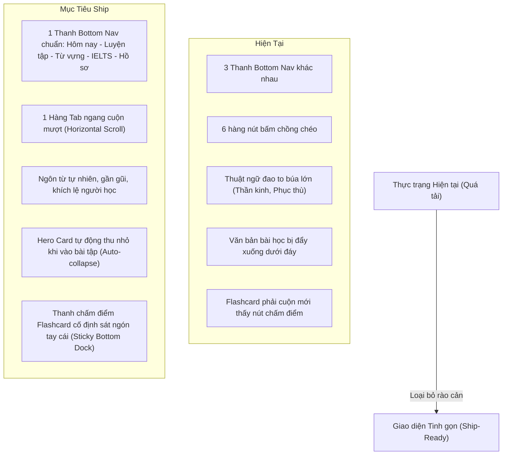

# Báo Cáo Thẩm Định UI/UX Vivo & Đánh Giá Khả Năng Ship App (2026-11-10)

> **Môi trường thẩm định:** vivo V2445A (360 x 803 px CSS, DPR 3.0x / 1080 x 2408 px)  
> **Tập screenshot phân tích:** 156 ảnh chụp thực tế tại `Mobile/vivo/` (6 phân hệ)  
> **Phương pháp:** Deep Think Protocol — Đối soát trực quan từng màn hình kết hợp kiểm tra mã nguồn

---

## 1. Kết Luận Chung: Có Thể Ship App Chưa?

### ❌ **QUYẾT ĐỊNH: CHƯA THỂ SHIP (NOT SHIP-READY)**

Ứng dụng sở hữu kho tính năng đồ sộ, hệ thống âm thanh/haptics chi tiết và nội dung sư phạm sâu. Tuy nhiên, về mặt **giao diện người dùng (UI), trải nghiệm (UX) và độ hoàn thiện sản phẩm thương mại**, app **chưa đủ điều kiện xuất xưởng**. Nếu phát hành ngay lúc này lên Google Play / App Store, app sẽ đối mặt với:
1. **Tỷ lệ gỡ app và đánh giá 1-sao cao** do trải nghiệm rối rắm, thuật ngữ hàn lâm khó hiểu ("khắc sâu thần kinh", "so khớp Myers-Hirschberg", "phục thù"), và các nút bị che khuất.
2. **Nguy cơ bị từ chối kiểm duyệt (App Store / Play Store Review)** do lộ các lệnh nội bộ của AI (`/boost`, `/ponytail ultra`) và hiển thị phím tắt bàn phím desktop (`Ctrl+K`, `Esc`) trên màn hình cảm ứng di động.
3. **Mất phương hướng điều hướng:** Ứng dụng tồn tại tới 3 thanh điều hướng đáy (Bottom Nav Bar) hoàn toàn khác nhau nhảy qua lại giữa các màn hình.

---

## 2. Danh Mục Các Lỗi Lớn (Flaws) Phát Hiện Từ Screenshot

### 🚨 Nhóm A: Lỗi Nghiêm Trọng Cản Trở Ship (Blockers)

| # | Màn hình vi phạm | Chi tiết lỗi | Bằng chứng ảnh |
|---|---|---|---|
| **A1** | `02-navigation-hud/14-floating-scratchpad-01-top.png` | **Lộ mã lệnh AI / Developer ra ngoài UI người dùng**: Các nút bấm có tên `⚡ /boost`, `✂️ /ponytail ultra`. Nội dung ghi chú mặc định chứa prompt nội bộ: *"- [ ] Generate 1 /brainstorming blueprint for IELTS Task 2"*, *"- [ ] Apply /ponytail ultra audit to simplify study notes"*. | Người dùng cuối nhìn thấy các slash command nội bộ của trợ lý lập trình. |
| **A2** | `04-mastery-foundations/04-collocations-lexicon-01-top.png` | **Phím tắt Desktop hiển thị trên Mobile**: Ô tìm kiếm hiển thị placeholder: `Tìm kiếm cụm từ... (Ctrl+K)`. Điện thoại di động không có phím Ctrl. | Gây ngơ ngác cho người dùng smartphone. |
| **A3** | `02-navigation-hud/06c-multiskill-assessment-question-01-top.png` | **Hướng dẫn phím tắt Desktop trên Touch UI**: Dưới chân màn hình trắc nghiệm hiển thị: `Phím tắt: 1 - 4 để chọn • Esc để thoát`. | Vi phạm nguyên tắc giao diện di động cảm ứng. |
| **A4** | `02-navigation-hud/06b-multiskill-assessment-intro-01-top.png` | **Đè chồng phần tử (Visual Collision)**: Nút đóng `✕` đè trực tiếp lên badge `🎯 RADAR THIÊN VĂN`. | Chữ và icon giao nhau, không thể nhìn rõ. |
| **A5** | `02-navigation-hud/06c-multiskill-assessment-question-01-top.png` | **Đè chồng phần tử (Visual Collision)**: Nút đóng `✕` bị nhét chung vào bên trong ô số bước thứ 5 (`5✕`), trông như lỗi render font/icon. | Icon `✕` dính chặt vào số 5. |
| **A6** | `02-navigation-hud/04-settings-modal-02-scrolled.png` | **Bong bóng Notes che khuất nội dung**: Widget nổi `Notes 1` đè trực tiếp lên đoạn văn bản giải thích tính năng bên dưới, che mất chữ. | Không thể đọc được nội dung bị che. |
| **A7** | `02-navigation-hud/04-settings-modal-02-scrolled.png` | **Ngắt dòng nút toggle dị dạng**: Nút gạt bật/tắt bị ép hẹp khiến chữ vỡ làm 2 dòng: `BẬ` (dòng 1) và `T •` (dòng 2). | Lỗi layout CSS flex/inline-block. |

---

### ⚠️ Nhóm B: Phân Mảnh Điều Hướng (Navigation Fragmentation)

| # | Màn hình vi phạm | Chi tiết lỗi |
|---|---|---|
| **B1** | Toàn bộ app | **3 thanh Bottom Navigation Bar đá nhau**: <br>1. Main App: `HÔM NAY`, `HỌC`, `TỪ VỰNG`, `IELTS`, `TÔI`<br>2. Cài đặt / Drawer cũ: `CÂY`, `CHỚP`, `RADAR`, `THI`, `THÊM`<br>3. Phân hệ IELTS: `LỘ TRÌNH`, `ĐỌC`, `NGHE`, `VIẾT`, `THI THỬ`<br>👉 Người dùng không có một mental model thống nhất; mỗi lần chuyển view lại thấy thanh đáy biến hình đổi icon và nhãn. |
| **B2** | Các trang con (`03-four-pillars`, `04-mastery-foundations`) | **Nút Back gây hiểu lầm**: Nút quay lại ở góc trên bên trái ghi nhãn `← CÂY`. Người dùng phổ thông không hiểu "Cây" là gì (chỉ người làm dev mới hiểu đó là Cây kỹ năng / Skill Tree). Nên là `← Quay lại` hoặc icon `←`. |
| **B3** | `06-ielts-academic/10-ielts-speaking-simulator-01-top.png` | **Xuất hiện 2 nút Back cùng lúc**: Trên cùng có `← IELTS 7.0`, ngay dưới lại có `← Quay lại Luyện Nói`. Người dùng bối rối không biết bấm nút nào để quay về đâu. |
| **B4** | `02-navigation-hud/02-living-canvas-01-top.png` | **Mất lối thoát (Trap UI)**: Khi chuyển sang tab "Bản đồ Sao", 2 tab chuyển đổi (`Lưới Kỹ năng` / `Bản đồ Sao`) biến mất hoàn toàn. Màn hình chỉ còn một radar tròn giữa nền đen, không có nút chuyển lại dạng Lưới ngoại trừ bấm vào thanh đáy. |

---

### 🧩 Nhóm C: Trải Nghiệm Công Thái Học Kém (Ergonomics & Cognitive Overload)

| # | Màn hình vi phạm | Chi tiết lỗi |
|---|---|---|
| **C1** | `04-mastery-foundations/02-vocab-back-01-top.png` | **Flashcard lật xong không thấy nút chấm điểm**: Khi lật thẻ từ vựng ra mặt sau, các nút đánh giá (`✕ Học lại`, `✓ Nhớ tốt`) bị trôi xuống dưới màn hình. Người dùng bắt buộc phải cuộn tay xuống mỗi khi học 1 từ. Học 50 từ phải cuộn 50 lần! |
| **C2** | `03-four-pillars/01-reading-pass1-01-top.png` | **Văn bản bài đọc bị đẩy xuống dưới màn hình 1**: Màn hình đầu tiên bị chiếm trọn bởi: Header app -> Hero card -> Carousel chọn bài -> 6 nút chọn CEFR -> Đo lường WPM -> 4 nút bước đọc. Bài đọc thực tế không hề xuất hiện ở màn hình đầu tiên, bắt buộc phải scroll mới thấy chữ đầu tiên. |
| **C3** | `04-mastery-foundations/08-tenses-gauntlet-01-top.png` | **Câu hỏi luyện tập bị đẩy xuống đáy**: Khi làm bài 12 Thì, 3 nút bấm khổng lồ (`Luyện ngẫu nhiên`, `Thử thách 12 Thì`, `Cẩm nang`) vẫn nằm cố định phía trên, đẩy câu hỏi và ô chọn đáp án trôi xuống dưới. |
| **C4** | `04-mastery-foundations/08b-tenses-gauntlet-scorecard-01-top.png` | **Hoàn thành bài thi vẫn hiện menu chọn bài**: Khi nộp bài và nhận bảng điểm, đỉnh màn hình vẫn hiển thị nguyên cụm chọn bài, đẩy bảng điểm chiến thắng xuống nửa dưới bị cắt cụt. |
| **C5** | `03-four-pillars/03-writing-scaffold-01-top.png` & `05-writing-diff-01-top.png` | **Lặp tiêu đề 2 lần giống hệt nhau**: Hero card ghi `TRỤ CỘT 03 // PHƯƠNG PHÁP FRANKLIN COPYWORK` và `REGISTER: Professional Correspondence`. Ngay dưới thẻ lại lặp lại y nguyên 2 dòng chữ đó thêm một lần nữa. |
| **C6** | `06-ielts-academic/03-ielts-reading-timed-01-top.png` | **Nhân đôi điều khiển (Duplicate Controls)**: Đồng hồ `19:59` và nút `Bài đọc` vừa xuất hiện ở card phía trên, vừa xuất hiện ở dock cố định phía dưới. |

---

### 📏 Nhóm D: Lỗi Typography, Cắt Chữ & Vi Phạm Quy Chuẩn

| # | Màn hình vi phạm | Chi tiết lỗi |
|---|---|---|
| **D1** | `04-mastery-foundations/10-cambridge-drills-01-top.png` | **Xếp chồng 6 hàng nút bấm ngang (Vi phạm nghiêm trọng Invariant 7)**: <br>- Hàng 1: `Bài tập`, `Lộ trình Đột phá`<br>- Hàng 2: `Tiếng Anh Toàn cầu`, `Ngữ âm`<br>- Hàng 3: `Thư điện tử` (1 nút lẻ)<br>- Hàng 4: `All`, `Grammar`, `Vocabulary`<br>- Hàng 5: `Listening`, `Pronunciation`, `Reading`<br>- Hàng 6: `Writing` (1 nút lẻ)<br>👉 6 hàng nút chiếm hơn nửa chiều cao màn hình trước khi đến nội dung bài học. |
| **D2** | `02-navigation-hud/01-constellation-deck-01-top.png` | **Cắt cụt chữ không đọc được (Severe Ellipsis)**: 3 chip nhiệm vụ dưới mục "3 CÒN LẠI" bị cắt thành `○ 0/...`, `○ 1 B...`, `○ 1 ...`. Không ai đọc được là nhiệm vụ gì. |
| **D3** | `05-exam-cockpit-reading-01-top.png` | **Cắt cụt dạng bài thi IELTS**: <br>- `(TRUE / FALSE / NOT)` (mất chữ `GIVEN`)<br>- `(Sentence Completio)` (mất chữ `n`)<br>- `(TFNG & Short Answe)` (mất chữ `r`)<br>- `(Multiple Choice & )` (dấu `&` lửng lơ mất đuôi) |
| **D4** | `06-ielts-academic/07-ielts-writing-prompts-01-top.png` & `13-ielts-mock-exam-01-top.png` | **Cắt cụt mô tả trong Hero Card**: `Task 2: viết bài luậ...`, `60 phút kèm cả...`, `Đọc hiểu chiếm phầ...`. |
| **D5** | `06-ielts-academic/05-ielts-listening-audio-01-top.png` & `10-ielts-speaking-simulator-01-top.png` | **Tab bị cắt ngang mép phải**: `✍️ Micro-Dictatic...`, `Phần 2: Phòng L...`. |
| **D6** | `02-navigation-hud/07-rpg-progression-01-top.png` | **Ngắt từ tiếng Việt sai quy cách**: Dòng chữ bị ngắt thành `TIẾN TRÌNH LÊN HẠNG KẾ` (dòng 1) và `TIẾP` (dòng 2). Chữ "Kế tiếp" bị xé đôi. Tương tự: `VÒNG LẶP ÂM THANH TỰ` / `HÀNH`. |
| **D7** | `04-mastery-foundations/01-vocab-front-01-top.png` | **Thiếu dấu phân cách số liệu**: Hiển thị `Thẻ 1 / 5 0 đã ôn`. Hai số `5` và `0` dính liền khiến người dùng tưởng là `50 thẻ`. Cần ghi rõ: `Thẻ 1 / 5 • 0 đã ôn`. |

---

### 🌐 Nhóm E: Thiếu Nhất Quán Ngôn Ngữ & Bản Địa Hóa (i18n Parity)

Mặc dù app đang chọn ngôn ngữ tiếng Việt (`VI`), hàng chục màn hình vẫn bị rò rỉ tiếng Anh chưa dịch:
- `03-four-pillars/01-reading-pass1-02-scrolled.png`: Tab trái ghi `Văn bản đọc`, tab phải ghi tiếng Anh `Analysis & Exercises`.
- `04-mastery-foundations/10-cambridge-drills-01-top.png`: Bộ lọc phân loại dùng tiếng Anh toàn bộ: `All`, `Grammar`, `Vocabulary`, `Listening`, `Pronunciation`, `Reading`, `Writing`.
- `04-mastery-foundations/11-phonemic-sounds-01-top.png`: Hướng dẫn nguyên đoạn tiếng Anh: *"Tap a symbol to inspect physical articulatory mechanics..."*.
- `04-mastery-foundations/12-email-builder-01-top.png`: Trộn lẫn *"Mục tiêu: get the report by Friday • Gửi đến: a colleague you work with every day"*; nhãn *"VĂN PHONG: NEUTRAL"*.
- `04-mastery-foundations/09-lexicon-drawer-01-top.png`: Nút bấm tiếng Anh `+ Add to SRS Deck`.
- `05-speed-mediation-habits/02-mediation-workbench-01-top.png`: `Scenario 1 of 2`, `Data & Visuals`, `0 / 62 words`.
- `06-ielts-academic/08-ielts-writing-blueprints-01-top.png`: Hàng tab phân loại dạng bài hoàn toàn tiếng Anh: `Line`, `Bar`, `Pie`, `Table`, `Process`.

---

### 🧠 Nhóm F: Giọng Văn Đao To Búa Lớn, Đầy Thuật Ngữ "AI-Slop"

Giao diện đang sử dụng hàng loạt thuật ngữ mang tính lý thuyết hàn lâm, tâm lý học thần kinh hoặc kiếm hiệp/chiến trận gây áp lực nặng nề cho người học:
1. **"Đo lường Khắc sâu Thần kinh"** (*Neural Engraving*): Quá kỳ quặc đối với một người muốn học tiếng Anh giao tiếp hoặc IELTS. Chỉ cần ghi: **"Đo lường Mức độ Ghi nhớ"**.
2. **"Đấu trường Bóc bẫy L1 & Phục thù (15s Blitz)"**, **"Tiêu diệt thói quen dịch thô"**, **"Chém bẫy phản xạ ngay"**: Ngôn từ bạo lực, hiếu chiến, xa lạ với phong cách "Apple-Calm" tinh tế mà bản đặc tả đề ra. Nên đổi thành: **"Sửa Lỗi Dịch Thô (L1)"**, **"Luyện Phản Xạ Nhanh"**.
3. **"So khớp Myers-Hirschberg"**: Đây là tên thuật toán so sánh chuỗi trong khoa học máy tính! Người học tiếng Anh không cần biết tên thuật toán của lập trình viên. Chỉ cần ghi: **"Đối chiếu Kết quả"** hoặc **"Xem Lỗi sai"**.
4. **"Hệ số tải nhận thức: Cấp độ Nâng cao"**: Đổi thành **"Độ khó: Nâng cao"**.
5. **"Vòng lặp âm thanh tự hành"**: Đổi thành **"Nghe Rảnh Tay Khi Di Chuyển"**.
6. **"Radar thiên văn"**: Đổi thành **"Radar Năng Lực CEFR"**.
7. **"Đặc quyền"** (*4/8 Đặc quyền, 9/16 Đặc quyền*): Nghe như tính năng hội viên VIP game online. Thực chất đây là các bài học/kỹ năng trong lộ trình. Nên đổi thành: **"4/8 Bài học"** hoặc **"4/8 Kỹ năng"**.
8. **"Xếp lớp 7 / 7.5"** trong lộ trình IELTS: Dịch sai ngữ cảnh (*Placement* -> Xếp lớp học sinh lớp 7). Cần sửa thành: **"Band hiện tại: 7.0 / 7.5"**.

---

### 📸 Nhóm G: Lỗi Tooling & Kịch Bản Chụp Screenshot Vivo

Trong tập 156 ảnh vivo được cung cấp:
- Có tới **35 ảnh là bản sao trùng lặp byte** (byte-copies) do script click modal không thành công.
- `04-settings-modal-01-top.png` thực chất chụp trúng màn hình `#tree` vì hàm mở modal bị lỗi.
- `11-corner-compass-01-top.png` và `13-level-picker-modal-01-top.png` thực chất chỉ là ảnh chụp màn hình `#read` vì trigger selector không tồn tại trong DOM lúc chụp.
- Báo cáo tự động `AUDIT-REPORT.json` ghi nhận "0 Defects" là do script chỉ kiểm tra overflow ở cấp độ `document.scrollWidth`, không quét được `overflow: hidden` bên trong các flex container hay các text bị cắt bởi `text-overflow: ellipsis`.

---

## 3. Đề Xuất Nâng Cấp UX (UX Overhaul Proposal) Để Tinh Gọn, Đẹp & Dễ Hiểu

### 🎯 Chiến lược: "Apple-Calm & Single-Loop Focus"



---

### 1. Đồng Nhất Triệt Để Hệ Thống Điều Hướng (Navigation Architecture)
1. **Một Bottom Nav duy nhất cho toàn bộ app**:
   - Tab 1: **Hôm nay** (`Sparkles` - Daily flow, streak, mục tiêu ngày)
   - Tab 2: **Học tập** (`Book` - Lộ trình 4 kỹ năng & Ngữ pháp)
   - Tab 3: **Từ vựng** (`Layers` - Flashcards SRS & Collocations)
   - Tab 4: **IELTS** (`GraduationCap` - Trung tâm luyện đề & Thi thử Academic)
   - Tab 5: **Tôi** (`Trophy` - Tiến độ, Cài đặt, Lịch sử làm bài)
   - *Xóa bỏ vĩnh viễn thanh nav `CÂY - CHỚP - RADAR - THI - THÊM` cũ và thanh nav riêng của IELTS khi tích hợp trong app.*
2. **Top App Bar chuẩn mực**:
   - Luôn có: `[Tên màn hình hiện tại]` ở giữa hoặc bên trái, `[Nút Back]` rõ ràng (nếu ở trang con), `[Icon Chuỗi ngày 🔥]` và `[Avatar / Cài đặt]`.
   - Bỏ toàn bộ chữ `← CÂY`. Đổi thành icon mũi tên `←` kèm tên màn hình trước đó (ví dụ: `← Bài đọc`, `← Lộ trình`).

---

### 2. Tinh Gọn Không Gian Đầu Trang (Header & Hero Compression)
1. **Collapsible Hero khi làm bài tập**:
   - Khi người dùng bắt đầu làm bài (Đọc, Nghe, Làm thì, Chẩn đoán), Hero card khổng lồ (chiếm 150-180px) phải **tự động co lại thành một thanh tóm tắt siêu nhỏ (Compact Pill ~36px)** hiển thị: *Tên bài • Cấp độ • Thời gian*.
   - Nhờ đó, 80% màn hình dành trọn cho nội dung câu hỏi, đoạn văn và các lựa chọn đáp án mà không cần cuộn trang.
2. **Triệt tiêu vấn đề 6 hàng nút bấm (Tabs & Filter Pills)**:
   - Gom tất cả các bộ lọc thành **đúng 1 hàng duy nhất có thể vuốt ngang (Horizontal Scroll)** với thuộc tính CSS:
     ```css
     display: flex;
     flex-wrap: nowrap;
     overflow-x: auto;
     -webkit-overflow-scrolling: touch;
     gap: 8px;
     scrollbar-width: none;
     ```
   - Nhóm bài tập: `Tất cả` | `Ngữ pháp` | `Từ vựng` | `Nghe` | `Phát âm` | `Đọc` | `Viết` cuộn êm ái, chạm nhẹ lướt ngang như App Store / Spotify.

---

### 3. Tối Ưu Công Thái Học Cho Ngón Tay Cái (Thumb Zone Ergonomics)
1. **Flashcard Review Dock cố định**:
   - Khi học từ vựng (SRS), thanh đánh giá kết quả (`✕ Học lại` - `✓ Nhớ tốt`) phải nằm ở **vị trí Sticky ngay trên thanh Bottom Nav** (hoặc toàn màn hình ở chế độ học).
   - Tuyệt đối không để trôi xuống đáy trang web bắt cuộn. Người dùng chỉ cần cầm máy bằng 1 tay là có thể gõ nhẹ ngón cái liên tục qua hàng trăm thẻ.
2. **Xử lý Widget nổi (Floating Note)**:
   - Nút `Notes` nổi cần có cơ chế tự động ẩn (Auto-hide) khi màn hình đang ở trạng thái cuộn hoặc khi người dùng đang làm bài thi để tránh che khuất nút chức năng và chữ đọc.
   - Xóa bỏ ngay các nút `/boost`, `/ponytail` trong Note; thay bằng các template học tập thực tế: `📝 Tóm tắt ý chính`, `💡 Cụm từ cần nhớ`, `❓ Điểm thắc mắc`.

---

### 4. Thay Máu Ngôn Từ Giao Diện (Microcopy Revolution)
Chuyển toàn bộ ngôn ngữ ứng dụng từ "Hàn lâm / Hiếu chiến" sang "Thân thiện / Apple-Calm":

| Cụm từ cũ trong App | Cụm từ mới đề xuất | Lý do cải thiện |
|---|---|---|
| Đo lường Khắc sâu Thần kinh | **Đo lường Mức độ Ghi nhớ** | Dễ hiểu, gần gũi với việc học ngoại ngữ |
| Đấu trường Bóc bẫy L1 & Phục thù | **Sửa Lỗi Tư Duy Dịch Thô** | Xóa bỏ tính bạo lực/game rác, tập trung giá trị học |
| Tiêu diệt thói quen dịch thô | **Khắc phục lỗi dịch từng từ** | Tự nhiên, mang tính hướng dẫn tích cực |
| Chém bẫy phản xạ ngay | **Luyện phản xạ nhanh (60s)** | Bỏ từ "chém", lịch sự và chuyên nghiệp |
| So khớp Myers-Hirschberg | **So sánh với Bài mẫu** | Người dùng không cần biết thuật toán máy tính |
| Hệ số tải nhận thức: Cấp độ Nâng cao | **Độ khó: Nâng cao** | Ngắn gọn, chuẩn ngôn ngữ sản phẩm |
| Vòng lặp âm thanh tự hành | **Nghe rảnh tay khi di chuyển** | Rõ ràng công năng cho người dùng |
| 4/8 Đặc quyền | **4/8 Kỹ năng** hoặc **4/8 Bài học** | Đúng bản chất giáo dục |
| Xếp lớp 7 / 7.5 | **Band hiện tại: 7.0 / 7.5** | Chuẩn thuật ngữ thang điểm IELTS |
| Tìm kiếm cụm từ... (Ctrl+K) | **Tìm kiếm cụm từ...** | Loại bỏ phím tắt máy tính trên mobile |
| Phím tắt: 1 - 4 để chọn • Esc để thoát | *(Xóa bỏ trên mobile)* | Điện thoại không có bàn phím vật lý |

---

## 4. Kế Hoạch Hành Động (Action Plan) Để Đạt Chuẩn Ship App

### Giai đoạn 1: Dọn Dẹp Lỗi Bắt Buộc (P0 - Trong 1-2 ngày)
- [ ] **Làm sạch Release**: Xóa hoàn toàn các tham chiếu `/boost`, `/ponytail ultra`, `/brainstorming` trong `floating-note.ts` và dữ liệu mẫu.
- [ ] **Mobile-Check phím tắt**: Xóa bỏ `(Ctrl+K)` và `Phím tắt 1-4 • Esc` trên các thiết bị cảm ứng di động.
- [ ] **Sửa va chạm layout (Collisions)**:
  - Tách nút đóng `✕` độc lập ở góc modal chẩn đoán, không để đè lên badge hay dính vào số 5.
  - Sửa nút gạt toggle bật/tắt để không vỡ chữ `BẬ \n T •`.
  - Thêm padding đáy `padding-bottom: calc(var(--bottom-nav-height, 60px) + env(safe-area-inset-bottom, 16px))` cho Drawer và Lexicon Drawer để nút `Đóng` không bị che khuất.
- [ ] **Bản địa hóa 100%**: Dịch toàn bộ các chuỗi tiếng Anh còn sót lại (`Analysis & Exercises`, `All`, `Grammar`, `Vocabulary`, `Listening`, `Reading`, `Writing`, `Scenario 1 of 2`, `NEUTRAL`, `+ Add to SRS Deck`) sang tiếng Việt trong từ điển `web/src/core/i18n.ts`.

### Giai đoạn 2: Tối Ưu Công Thái Học & Thống Nhất Điều Hướng (P1 - Trong 2-3 ngày)
- [ ] **Thống nhất Bottom Nav**: Áp dụng duy nhất thanh 5 tab hiện đại (`Hôm nay`, `Học tập`, `Từ vựng`, `IELTS`, `Tôi`) trên mọi phân hệ.
- [ ] **Chuyển Tab xếp tầng thành Vuốt ngang**: Đổi toàn bộ các cụm bộ lọc 6 hàng nút trong Cambridge Drills, Phonemic Sounds, Email Builder thành hàng cuộn ngang mượt mà.
- [ ] **Cố định nút chấm điểm Flashcard**: Thiết kế lại mặt sau thẻ từ vựng để các nút `Học lại` / `Nhớ tốt` luôn nằm trong vùng chạm ngón tay cái mà không cần cuộn trang.
- [ ] **Thu nhỏ Hero khi vào bài**: Cung cấp chế độ Compact Header khi người dùng đang đọc bài hoặc làm trắc nghiệm.

### Giai đoạn 3: Viết Lại Microcopy & Hoàn Thiện Thẩm Mỹ (P2 - Trong 1-2 ngày)
- [ ] Thay thế toàn bộ các thuật ngữ đao to búa lớn (thần kinh, phục thù, chém bẫy, Myers-Hirschberg, đặc quyền) bằng ngôn từ tinh tế, Apple-calm.
- [ ] Căn chỉnh text-overflow: Đảm bảo không còn bất kỳ chip nào bị cắt chữ `○ 0/...` hay dạng bài thi bị mất chữ `(TRUE / FALSE / NOT)`.
- [ ] Chạy lại kịch bản chụp toàn bộ màn hình Vivo (`scripts/capture-vivo-audit.cjs`) sau khi fix để xác nhận 100% màn hình đều sạch đẹp và sẵn sàng đóng gói APK/PWA.

