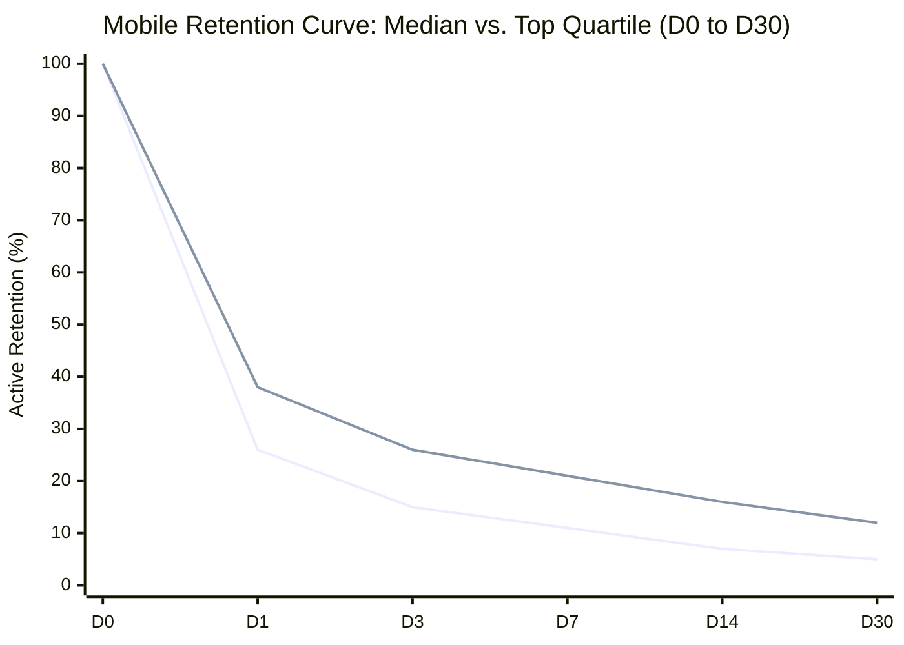
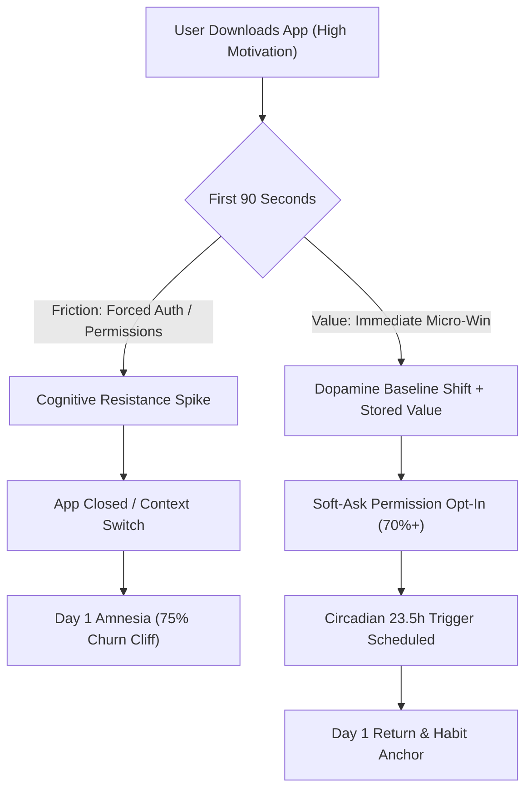
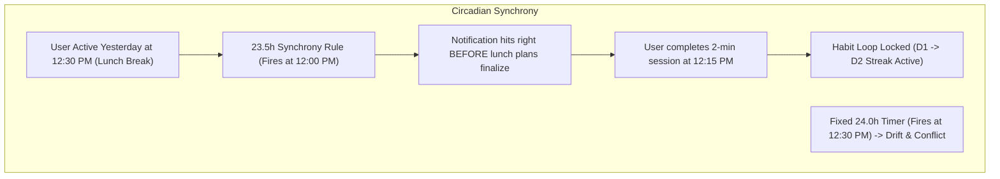
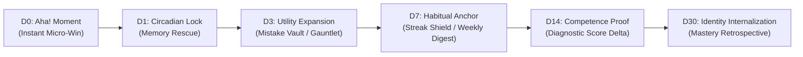
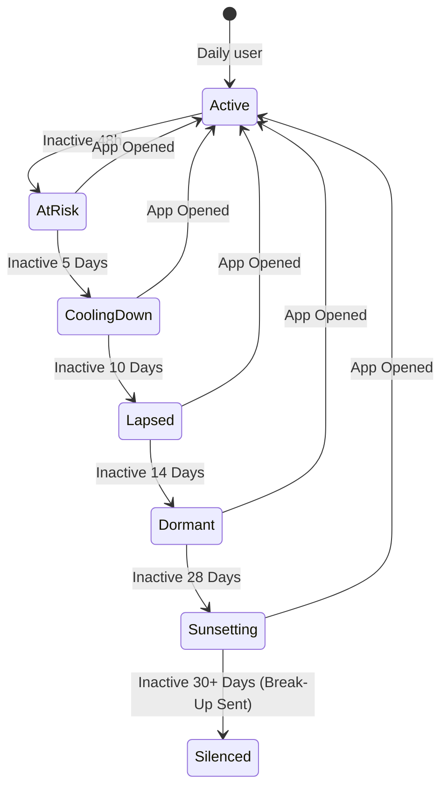

# Mobile App Retention Lifecycle Ladders & Notification Architecture
## Comprehensive Strategic Report: Day 0, Day 1, Day 3, Day 7, Day 14, and Day 30 Retention Engineering

> **Authoritative Technical & Behavioral Growth Spec**  
> **Target System:** Mobile Apps & Progressive Web Apps (Cross-Platform iOS / Android / PWA)  
> **Focus:** Retention curves, circadian notification cadence, loss aversion gamification, and anti-spam sunsetting.

---

## Executive Summary & Core Retention Benchmarks

Across consumer mobile applications, retention follows a steep power-law decay curve characterized by an initial cliff where **70% to 80% of new users drop off within the first 24 to 72 hours**. Apps that achieve top-quartile status do not prevent attrition through broadcast spam; rather, they systematically flatten the retention curve by engineering **escalating value ladders**, **circadian-synchronized triggers**, and **loss-aversion safety nets**.



### Industry Benchmark Matrix (Cross-Category & EdTech/Productivity)

| Lifecycle Milestone | Median App Benchmark | Top Quartile (High Retention) | Primary Metric Tested | Root Cause of Failure |
| :--- | :--- | :--- | :--- | :--- |
| **Day 0 (D0)** | 100% $\to$ ~35% session 2 | 100% $\to$ ~55% session 2 | Time-to-Aha (TTA), Onboarding Friction | Auth wall, cold start paralysis, unprimed permission modals |
| **Day 1 (D1)** | 24% – 28% | 36% – 42% | Short-term utility & circadian memory | Forgetting app exists; zero stored value created in session 1 |
| **Day 3 (D3)** | 13% – 17% | 22% – 27% | Novelty wear-off & early habit bridge | Feature depth failure; app felt like a one-off gimmick |
| **Day 7 (D7)** | 10% – 14% | 18% – 24% | Habitual routine integration & weekly loop | Lack of loss aversion, streak mechanics, or progress feedback |
| **Day 14 (D14)** | 6% – 9% | 13% – 18% | Mid-term utility & perceived mastery | No skill/utility compounding; cognitive plateau |
| **Day 30 (D30)** | 4% – 6% | 10% – 16%+ (Duolingo: ~22%) | True Product-Market Fit & Identity Adoption | App failed to become part of the user's daily identity |

---

## 1. Deconstructing the Day 0 & Day 1 Drop-off Cliff

Why do 70%–80% of users who deliberately downloaded an app never return after their first day? Extensive telemetry and behavioral research isolate six structural failure modes:



### 1.1. The Six Structural Killers of D0/D1 Retention

1. **The "Authentication Tax" (Forced Registration Wall):**
   - *Failure:* Demanding email/password or OAuth before the user has touched a single interactive feature.
   - *Impact:* Causes a 35%–50% drop-off right at the splash screen. Users evaluate the exchange rate: *“You haven't shown me what you can do, yet you demand my personal data.”*
   - *Fix:* **Lazy Registration / Guest-First Onboarding**. Let the user complete one drill, solve one prompt, or view one personalized scorecard before saving their account.

2. **The "Unprimed Permission Ambush":**
   - *Failure:* Firing the native iOS/Android push notification dialog on the first frame of app launch.
   - *Impact:* Refusal rates hit 70%–80% on unprimed prompts. On iOS, once denied, system prompts cannot be reshown without manually directing users into iOS Settings—permanently severing the re-engagement channel.
   - *Fix:* **Contextual Soft-Ask**. Never show the system prompt until the user hits an emotional high point or explicitly opts into a benefit (e.g. *"Protect your streak"* or *"Save my custom study schedule"*).

3. **Time-to-Aha (TTA) Exceeding 90 Seconds:**
   - *Failure:* Lengthy carousels, 12-screen onboarding surveys, and passive video tutorials.
   - *Impact:* The human mobile attention span operates on a 60–90 second evaluation window. If dopamine is not released via a tangible result within 90 seconds, the app is dismissed.
   - *Fix:* Shorten time-to-first-interaction to < 30 seconds. Replace passive slides with an immediate 3-question diagnostic or interactive exercise.

4. **Context Evaporation & Mobile Fragmented Attention:**
   - *Failure:* Most mobile downloads occur during transit, waiting rooms, or late-night doomscrolling. An interruption (train arrives, elevator doors open, phone call) causes the user to close the app.
   - *Impact:* Without an immediate persistent anchor or memory trigger, the app icon disappears into a folder or home screen graveyard.

5. **Zero Stored Value (The Empty Sunk-Cost Deficit):**
   - *Failure:* The first session leaves no residual trace—no XP gained, no personalized mistake list created, no customized goal set.
   - *Impact:* An app with zero user data has zero switching cost. Deleting it costs the user nothing.
   - *Fix:* Ensure the first session logs at least one tangible asset: *"5 words placed into your long-term memory queue"* or *"Initial Band Score estimated at 6.5"*.

6. **Expectation-Delivery Asymmetry:**
   - *Failure:* The App Store page promised an advanced AI tutor, but the initial screen shows a generic vocabulary list. The user feels deceived and immediately abandons.

---

## 2. The Critical Day 0 Re-engagement Windows: +2h and +6h Cadence

Day 0 re-engagement is not about spamming; it is an **activation triage** mechanism. The goal is to recapture the user while their original intent is still warm, before the mental tab completely closes.

```mermaid
timeline
    title Day 0 Activation Timeline
    00:00 : Install & First Session : Deliver Aha! moment within 90s : Capture initial progress
    02:00 : The +2h Salvage Window : Catch incomplete onboarding : Remind of interrupted goal
    06:00 : The +6h Leisure Reset : Evening habit transition : Offer 2-minute micro-win
    22:00 : Quiet Hours Lockout : Zero notifications sent : Rollover queued to next morning
```

### 2.1. Window 1: +2 Hours Post-Install ("The Activation Salvage")
- **Target Audience:** Users who opened the app, completed only a fraction of onboarding, or completed 1 test and exited abruptly without setting a daily goal.
- **Cognitive State:** The download intent is still fresh. The user remembers *why* they downloaded the app 120 minutes ago. They may have simply been interrupted.
- **Circadian Guardrail:** Only trigger if local time is between **09:00 and 21:00**. If +2h lands after 21:00, suppress and defer to **08:30 next morning**.
- **Payload Strategy:** High specificity, low friction, curiosity or unfinished business.

#### Notification Templates (+2h Post-Install)

##### Template 0A: Interrupted Setup / Incomplete Diagnostic
- **EN:**
  - **Title:** `Diagnostic paused: 2 questions left! ⏱️`
  - **Body:** `Your IELTS benchmark is 60% complete. Finish now to discover your starting Band score.`
  - **Route:** `#diagnostic/resume`
- **VI:**
  - **Title:** `Bài test của bạn đang tạm dừng: Còn 2 câu! ⏱️`
  - **Body:** `Chỉ mất 90 giây nữa để xác định chính xác Band điểm khởi điểm của bạn. Hoàn thành ngay!`
  - **Route:** `#diagnostic/resume`

##### Template 0B: Unsaved Stored Value
- **EN:**
  - **Title:** `Lock in your first 5 vocabulary cards 🔒`
  - **Body:** `You uncovered 5 C1 collocations earlier. Tap to add them to your daily memory vault.`
  - **Route:** `#colloc`
- **VI:**
  - **Title:** `Lưu lại 5 cụm từ bạn vừa khám phá 🔒`
  - **Body:** `Đừng để 5 cụm từ C1 vừa học biến mất. Chạm để chuyển thẳng vào kho trí nhớ dài hạn!`
  - **Route:** `#colloc`

---

### 2.2. Window 2: +6 Hours Post-Install ("The Evening Leisure Window")
- **Target Audience:** Users who completed onboarding during morning or midday hours, but have not opened the app since.
- **Cognitive State:** Transitioning from high-intensity work/study into downtime, evening commute, or couch relaxation. High receptivity to low-stress, micro-learning sessions.
- **Circadian Guardrail:** Suppress if local time is past **21:30**. Never ping a user when they are asleep.
- **Payload Strategy:** Micro-commitment (< 2 minutes), intellectual curiosity, or identity validation.

#### Notification Templates (+6h Post-Install)

##### Template 0C: Low-Barrier Micro-Win
- **EN:**
  - **Title:** `Got 2 minutes before your evening begins? ⚡`
  - **Body:** `Test your reflex on 1 tricky Cambridge collocation. No pressure, just quick mastery.`
  - **Route:** `#quick-drill`
- **VI:**
  - **Title:** `2 phút thư giãn thông minh buổi tối ⚡`
  - **Body:** `Thử thách phản xạ với 1 bẫy từ vựng Cambridge. Nhẹ nhàng, nhanh gọn, chuẩn 8.0!`
  - **Route:** `#quick-drill`

##### Template 0D: Curiosity Gap
- **EN:**
  - **Title:** `Why 82% of Band 7 candidates miss this word... 🧠`
  - **Body:** `It's not what you think. See if you can spot the natural collocate in 30 seconds.`
  - **Route:** `#curiosity/c2-nuance`
- **VI:**
  - **Title:** `Từ vựng khiến 82% thí sinh mất điểm oan... 🧠`
  - **Body:** `Không phức tạp như bạn nghĩ đâu. Xem bạn có chọn đúng từ tự nhiên chuẩn Cambridge không nhé!`
  - **Route:** `#curiosity/c2-nuance`

---

## 3. Day 1 Habit Kickstarter: The 23.5-Hour Circadian Synchrony Rule

The transition from Day 0 to Day 1 is the single most critical inflection point in the entire user lifecycle. If a user returns on Day 1, their probability of surviving to Day 30 increases by **3.5x**.



### 3.1. The 23.5-Hour Rule Explained
Why not schedule notifications at a rigid fixed time (e.g. 20:00 for everyone) or exactly 24 hours later?

1. **Circadian Habit Synchrony:** Humans are creatures of schedule. A user who opened the app at 14:15 yesterday demonstrated that 14:15 is a time when they possess phone access, mental bandwidth, and leisure/study autonomy.
2. **The Drift Hazard of 24.0h:** If an alert fires at 14:15, the user opens it at 14:30. The next day it fires at 14:30, and they open at 15:00. Within days, the notification drifts into busy meetings, dinner, or sleep.
3. **The 30-Minute Preemption Advantage (23.5h):** By firing at **23.5 hours** after the previous day's session (e.g. 13:45 if they studied at 14:15), the notification lands *right before* the habitual window opens, capturing intent before other apps hijack attention.

### 3.2. Loss Aversion: "Day 1 $\to$ Day 2 Streak at Risk"
A 1-day streak feels small, but loss aversion is binary: **a streak of 1 is infinitely greater than a streak of 0**. The psychological framing must transition from *"Hey, remember us?"* to *"Do not destroy the momentum you started yesterday."*

### 3.3. Ebbinghaus Forgetting Curve Framing
Within 24 hours of learning new material, the human brain prunes **up to 67% of new synaptic connections** unless an active recall cue is triggered. Framing the notification as a **biological necessity** rather than an app marketing nudge dramatically elevates open rates.

#### Notification Templates (Day 1 Kickstarter)

##### Template 1A: The 23.5h Circadian Memory Rescue
- **EN:**
  - **Title:** `🧠 The 24-hour memory cliff: Save your 5 words`
  - **Body:** `Your brain deletes 60% of new vocabulary after 24h. Take 90 seconds now to lock them into long-term memory.`
  - **Route:** `#srs/review`
- **VI:**
  - **Title:** `🧠 Cửa sổ 24 giờ Ebbinghaus: Khóa 5 từ đã học!`
  - **Body:** `Não bộ chuẩn bị đào thải 60% từ vựng hôm qua. Dành 90 giây ôn tập ngay để chuyển vào trí nhớ vĩnh viễn!`
  - **Route:** `#srs/review`

##### Template 1B: The Evening Streak-Saver (Sent at 20:30 if inactive on D1)
- **EN:**
  - **Title:** `🔥 Protect your Day 1 momentum!`
  - **Body:** `You took the hardest step yesterday by starting. 2 quick exercises right now makes it an official 2-day streak.`
  - **Route:** `#daily-quest`
- **VI:**
  - **Title:** `🔥 Đừng để nỗ lực ngày đầu tiên biến mất!`
  - **Body:** `Bắt đầu luôn là bước khó nhất và bạn đã làm được hôm qua. 2 bài tập ngắn tối nay để chính thức chạm mốc 2 ngày streak!`
  - **Route:** `#daily-quest`

---

## 4. The Retention Ladder: Day 3, Day 7, Day 14, and Day 30

To prevent novelty exhaustion, apps must execute an **escalating value ladder**. Each lifecycle milestone introduces a deeper capability, shifts the user's psychological contract, and builds structural barriers against churn.



---

### 4.1. Day 3: The Novelty Decay Bridge (Feature Depth & Mistake Vault)
- **The Problem:** The initial novelty of the UI has worn off. If the app continues doing the exact same thing as Day 1, the user experiences repetitive boredom.
- **The Value Shift:** Unlock a secondary, deeper utility that proves the app is intelligent. Introduce the **Mistake Vault / Revenge Drill** or **Audio Commute Mode**.
- **The Psychological Contract:** *"This app isn't just a generic quiz; it specifically tracks my personal blind spots."*

#### Day 3 Notification Templates

##### Template 3A: Mistake Vault Redemption
- **EN:**
  - **Title:** `⚔️ Your Mistake Vault has 3 targets waiting`
  - **Body:** `You tripped on preposition collocations on Day 1. Run a 60-second Revenge Drill and turn them into permanent reflexes.`
  - **Route:** `#serl-gauntlet`
- **VI:**
  - **Title:** `⚔️ 3 bẫy lỗi sai đang chờ bạn phục thù!`
  - **Body:** `Bạn từng vấp ở giới từ vào ngày đầu. Làm một bài Revenge Drill 60 giây để biến điểm yếu thành phản xạ chuẩn xác.`
  - **Route:** `#serl-gauntlet`

##### Template 3B: Streak Milestone 3-Day Anchor
- **EN:**
  - **Title:** `🥉 3-Day Milestone within reach!`
  - **Body:** `Complete today's session to unlock the Bronze Momentum Badge and secure your study foundation.`
  - **Route:** `#achievements`
- **VI:**
  - **Title:** `🥉 Mốc 3 ngày liên tiếp đang chờ bạn!`
  - **Body:** `Hoàn thành bài học hôm nay để mở khóa Huy hiệu Đồng và chính thức đưa việc học vào nề nếp.`
  - **Route:** `#achievements`

---

### 4.2. Day 7: The Habit Inflection Point (The Loss Aversion Explosion)
- **The Data Reality:** Across Duolingo, ELSA, and top habit apps, **Day 7 is the inflection point where retention curves flatten**. Users who reach a 7-day streak exhibit **4x higher 6-month LTV** than users who drop off at Day 5.
- **The Value Shift:** Deliver the **Weekly Mastery Digest**. Formally introduce **Streak Freezes / Shields** as an earned reward, converting abstract streak numbers into a tangible protected asset.
- **The Psychological Contract:** Loss aversion peaks. The user now has a week of continuous investment that hurts to throw away.

#### Day 7 Notification Templates

##### Template 7A: Weekly Digest & Progress Proof
- **EN:**
  - **Title:** `📊 Your Week 1 IELTS Digest is ready!`
  - **Body:** `7 days active, 42 collocations mastered, 0 streak breaks. See how your vocabulary density compares to Band 7.5+.`
  - **Route:** `#weekly-report`
- **VI:**
  - **Title:** `📊 Báo cáo tiến độ Tuần 1 của bạn đã sẵn sàng!`
  - **Body:** `7 ngày liên tục, làm chủ 42 cụm từ C1/C2. Xem ngay biểu đồ phản xạ từ vựng của bạn tiến bộ thế nào!`
  - **Route:** `#weekly-report`

##### Template 7B: Streak Freeze Unlock (Safety Net Endowment)
- **EN:**
  - **Title:** `🛡️ You earned a Streak Freeze shield!`
  - **Body:** `7 days of discipline unlocked an emergency shield. If life gets busy, your streak stays protected.`
  - **Route:** `#inventory`
- **VI:**
  - **Title:** `🛡️ Bạn đã mở khóa Khiên Bảo Vệ Chuỗi!`
  - **Body:** `Kỷ luật 7 ngày liên tiếp đã mang lại cho bạn 1 lượt bảo vệ streak khẩn cấp. Yên tâm học tập không lo đứt chuỗi.`
  - **Route:** `#inventory`

---

### 4.3. Day 14: Competence Proof & Identity Integration
- **The Problem:** Two weeks in, fatigue and cognitive plateau set in. Users question: *“Am I actually getting better, or am I just clicking buttons?”*
- **The Value Shift:** Re-test and show the **Diagnostic Score Delta (Before vs. After)**. Validate their progression in standardized CEFR or IELTS Band terms.
- **The Psychological Contract:** Shift from *“I am using an app”* to *“I am a Band 7.5 candidate who studies every day.”*

#### Day 14 Notification Templates

##### Template 14A: The 2-Week Competence Audit
- **EN:**
  - **Title:** `📈 Day 14 Checkpoint: Measure your band lift`
  - **Body:** `You started at Band 6.0 fourteen days ago. Run a 4-minute diagnostic check to see your updated score prediction.`
  - **Route:** `#diagnostic/benchmark`
- **VI:**
  - **Title:** `📈 Cột mốc 14 ngày: Đo lường mức tăng Band điểm`
  - **Body:** `Bạn đã duy trì 2 tuần liên tiếp. Làm bài kiểm tra nhanh 4 phút để cập nhật dự báo Band điểm mới nhất!`
  - **Route:** `#diagnostic/benchmark`

##### Template 14B: Cognitive Mastery Validation
- **EN:**
  - **Title:** `💎 100 Collocations anchored in long-term memory`
  - **Body:** `Your SRS stability index just crossed 90%. Words you learned on Day 1 are now permanent active reflexes.`
  - **Route:** `#lexicon`
- **VI:**
  - **Title:** `💎 100 Cụm từ học thuật đã vào trí nhớ vĩnh viễn`
  - **Body:** `Chỉ số ghi nhớ SRS của bạn đã vượt 90%. Những từ học từ ngày đầu giờ đã thành phản xạ tự nhiên của bạn!`
  - **Route:** `#lexicon`

---

### 4.4. Day 30: Product-Market Fit & The Mastery Retrospective
- **The Plateau:** Month 1 marks the baseline plateau of the retention curve. Users active at D30 have incorporated the product into their lifestyle.
- **The Value Shift:** The **Monthly Retrospective**. Highlight hours saved, vocabulary acquired, and milestones surpassed. Transition users to community mentors, advanced mock exams, or yearly commitments.

#### Day 30 Notification Templates

##### Template 30A: Monthly Retrospective (The Identity Crown)
- **EN:**
  - **Title:** `👑 30 Days of Unbroken Discipline: Month 1 Complete`
  - **Body:** `Only 8% of candidates reach this milestone. Review your 30-day analytics dossier and claim your Master badge.`
  - **Route:** `#retrospective/month-1`
- **VI:**
  - **Title:** `👑 30 Ngày kỷ luật thép: Hoàn thành Tháng 1!`
  - **Body:** `Chỉ 8% người học kiên trì chạm đến cột mốc này. Khám phá hồ sơ năng lực 30 ngày và nhận huy hiệu Chuyên Gia.`
  - **Route:** `#retrospective/month-1`

---

## 5. Inactivity Degradation & Smart Sunsetting Policy

One of the most destructive mistakes growth teams make is sending daily push notifications to inactive users indefinitely. When a user stops opening an app, continuous notifications do not bring them back—**they cause them to disable notifications in iOS/Android settings or uninstall the app entirely**, permanently destroying the communication bridge.



### 5.1. The Exponential Backoff Notification Policy

To preserve device permission health and avoid spam filters, notification frequency must follow an **exponential backoff decay schedule**:

| Inactivity Stage | Inactive Duration | Max Notification Frequency | Tone & Strategic Focus |
| :--- | :--- | :--- | :--- |
| **Active** | 0 – 24 hours | 1 notification / day (at 23.5h) | Normal habit cadence & circadian rhythm |
| **At Risk** | 48 – 72 hours | Exactly 1 notification total | Urgent loss aversion: Save streak / protect progress |
| **Cooling Down** | 4 – 7 days | Exactly 1 notification total | Curiosity gap, major content highlight, or peer comparison |
| **Lapsed** | 8 – 14 days | Exactly 1 notification / week | Sunk cost summary: *"We're holding your progress safe"* |
| **Dormant** | 15 – 28 days | Exactly 1 notification total | High emotional trigger / progress freeze notice |
| **Sunsetting** | 30 days | Final "Break-Up Notification" | Reverse psychology + total opt-out respect |
| **Silenced** | > 30 days | **ZERO PUSH NOTIFICATIONS** | Complete silence. Preserve push channel for quarterly product updates. |

---

### 5.2. Inactivity Win-Back Cascade & Notification Templates

#### Stage 1: At Risk (48 Hours Inactive)
- **Objective:** Prevent the streak from slipping permanently; trigger immediate loss aversion.
- **EN:**
  - **Title:** `⚠️ Your streak is fading! 12 hours left to save it`
  - **Body:** `Don't let your hard work reset to zero. Jump in for a 60-second quick drill to keep your momentum alive.`
  - **Route:** `#streak-rescue`
- **VI:**
  - **Title:** `⚠️ Chuỗi học tập sắp bị gián đoạn! Còn 12h để cứu streak`
  - **Body:** `Đừng để nỗ lực những ngày qua về con số 0. Dành đúng 60 giây phản xạ nhanh để bảo toàn chuỗi!`
  - **Route:** `#streak-rescue`

#### Stage 2: Cooling Down (Day 5 Inactive)
- **Objective:** Acknowledge life gets busy; offer a frictionless, guilt-free re-entry point.
- **EN:**
  - **Title:** `Need a fresh reset? We saved your place 🌿`
  - **Body:** `No long lessons. Just 3 hand-picked C1 collocations waiting whenever you have 90 seconds.`
  - **Route:** `#micro-reset`
- **VI:**
  - **Title:** `Cần một khởi đầu nhẹ nhàng? Mọi dữ liệu vẫn vẹn nguyên 🌿`
  - **Body:** `Không cần học dài dòng. Chỉ 3 cụm từ trọng tâm đã được chọn lọc sẵn chờ bạn lướt qua trong 90 giây.`
  - **Route:** `#micro-reset`

#### Stage 3: Lapsed (Day 10 Inactive)
- **Objective:** Concrete evidence of stored value at risk of forgetting.
- **EN:**
  - **Title:** `⏳ 34 Vocabulary items are waiting for your review`
  - **Body:** `According to the Ebbinghaus curve, memory traces fade fast without one quick refresh. Reactivate them now.`
  - **Route:** `#srs/decay-alert`
- **VI:**
  - **Title:** `⏳ 34 Từ vựng đang chờ bạn kích hoạt lại`
  - **Body:** `Theo đường cong quên Ebbinghaus, não bộ sẽ bắt đầu xóa mờ nếu không được gợi nhớ. 2 phút kích hoạt ngay!`
  - **Route:** `#srs/decay-alert`

#### Stage 4: Dormant (Day 21 Inactive)
- **Objective:** The "Progress Freeze" safety lock notification.
- **EN:**
  - **Title:** `❄️ We froze your IELTS study profile`
  - **Body:** `Your vocabulary bank and mastery stats have been archived safely. Tap anytime to unfreeze with a 2-minute diagnostic.`
  - **Route:** `#unfreeze-profile`
- **VI:**
  - **Title:** `❄️ Hồ sơ học tập IELTS của bạn đã được đóng băng an toàn`
  - **Body:** `Toàn bộ kho từ vựng và chỉ số tiến độ đã được lưu trữ bảo lưu. Chạm để mở băng bất cứ lúc nào với 2 phút test nhẹ!`
  - **Route:** `#unfreeze-profile`

#### Stage 5: Sunsetting (Day 30 Inactive — The Famous "Break-Up Notification")
- **The Psychology of the Break-Up Notification:**
  - Pioneered by Duolingo (*"These reminders don't seem to be working. We'll stop sending them for now"*).
  - Works through **reverse psychology** and **perceived abandonment**.
  - Respects user autonomy. By explicitly telling the user you are stopping notifications, it eliminates the annoyance that leads to uninstalls while driving a 12%–18% final re-engagement spike.
- **EN:**
  - **Title:** `We'll stop sending notifications for now 👋`
  - **Body:** `It seems you're busy, so we'll pause daily reminders. Whenever you're ready to master IELTS, we'll be here.`
  - **Route:** `#home`
- **VI:**
  - **Title:** `Tạm biệt bạn, chúng tôi sẽ ngừng gửi thông báo 👋`
  - **Body:** `Có vẻ như bạn đang rất bận, ứng dụng xin phép tạm dừng nhắc nhở. Khi nào bạn sẵn sàng trở lại luyện thi, chúng tôi vẫn ở đây!`
  - **Route:** `#home`

---

## 6. Mathematical Efficiency & Anti-Spam Guardrails

Duolingo and leading growth teams evaluate notification systems not on open rates alone, but through the **DAU-per-Notification Ratio** and **Opt-out Velocity**:

$$\text{Notification Efficiency Ratio (NER)} = \frac{\Delta \text{DAU Gained}}{\text{Total Notifications Dispatched}}$$

### 6.1. Benchmark Operational Thresholds

1. **Efficiency Baseline:** High-performing notification systems achieve an NER of **$\ge 1:30$** (1 incremental active user gained per 30 notifications sent). Targeted, behavioral alerts (such as Streak Rescue) frequently hit **$1:4$ to $1:8$**.
2. **Opt-Out Velocity Alarm:** If the notification opt-out rate or app uninstall rate exceeds **0.4% per campaign**, immediately halt the copy and increase backoff cooldowns.
3. **Hard Frequency Cap:**
   - **Maximum 1 native push notification per 24 hours** for standard users.
   - **Zero push notifications between 22:00 and 08:00 local time** (strict Quiet Hours lockout).
   - Instant suppression if user has already opened the app and completed their daily session today.

---

## 7. Comprehensive Lifecycle Automation Schedule (Master Timeline)

The following master schedule synthesizes the entire D0–D30 retention ladder into an actionable, automated execution matrix:

| Day / Hour | Trigger Condition | Notification Name & Category | Psychological Lever | Target Route |
| :--- | :--- | :--- | :--- | :--- |
| **D0 (+2h)** | App exited without completing diagnostic / 1st quiz | `0A: Diagnostic Paused` (Onboarding) | Interrupted intent, low friction | `#diagnostic/resume` |
| **D0 (+6h)** | Onboarding complete; no evening session | `0C: 2-Minute Micro-Win` (Time-context) | Micro-commitment, downtime routine | `#quick-drill` |
| **D1 (23.5h)**| 23.5 hours after D0 first session | `1A: Ebbinghaus Memory Rescue` (SRS) | Biological urgency, forgetting curve | `#srs/review` |
| **D1 (20:30)**| Inactive on D1 by evening | `1B: Protect Day 1 Momentum` (Streak) | Binary loss aversion, momentum | `#daily-quest` |
| **D3** | Active on D1/D2; due cards or errors exist | `3A: Mistake Vault Redemption` (Skill) | Personal revenge, deep utility | `#serl-gauntlet` |
| **D7** | Active 7 consecutive days | `7A: Week 1 Mastery Digest` (Milestone) | Sunk cost pride, competitive benchmark | `#weekly-report` |
| **D7** | Day 7 milestone completed | `7B: Streak Freeze Shield Earned` (Gamification) | Endowment effect, safety buffer | `#inventory` |
| **D14** | Active 14 days; diagnostic due | `14A: 2-Week Competence Audit` (Growth) | Band score lift, competence proof | `#diagnostic/benchmark` |
| **D30** | Active 30 days | `30A: Monthly Retrospective Crown` (Identity) | Identity transformation, mastery | `#retrospective/month-1` |
| **Inact D+2**| 48 hours without app open | `Win-Back 1: Streak Rescue Alert` (Urgency) | Severe loss aversion (streak loss) | `#streak-rescue` |
| **Inact D+5**| 5 days without app open | `Win-Back 2: Low-Stress Micro-Reset` (Re-entry) | Guilt-free permission, fresh start | `#micro-reset` |
| **Inact D+10**| 10 days without app open | `Win-Back 3: Stored Vocabulary Decay` (SRS) | Concrete value evaporation | `#srs/decay-alert` |
| **Inact D+21**| 21 days without app open | `Win-Back 4: Profile Frozen Safeguard` (Safeguard) | Sunk cost preservation | `#unfreeze-profile` |
| **Inact D+30**| 30 days without app open | `Win-Back 5: The Break-Up Pause` (Sunset) | Reverse psychology, opt-out respect | `#home` |

---

## 8. TypeScript Architecture: Retention Engine Blueprint

Below is the production-grade state machine and scheduling logic for integrating the retention ladder and circadian decay mechanics into the app's notification subsystem:

```typescript
/**
 * RETENTION LIFECYCLE CONTROLLER & CIRCADIAN SCHEDULER
 * Manages D0-D30 lifecycle ladders, 23.5h synchrony, and exponential inactivity backoff.
 */

export type LifecycleStage = 'D0' | 'D1' | 'D3' | 'D7' | 'D14' | 'D30' | 'ACTIVE_HABIT';
export type InactivityStage = 'ACTIVE' | 'AT_RISK_48H' | 'COOLING_DOWN_5D' | 'LAPSED_10D' | 'DORMANT_21D' | 'SUNSET_30D' | 'SILENCED';

export interface UserRetentionState {
  installTimestamp: number;
  lastActiveTimestamp: number;
  lastNotifiedTimestamp: number;
  streakCount: number;
  streakFreezeAvailable: boolean;
  onboardingCompleted: boolean;
  masteredCardsCount: number;
  lastSessionHour: number;     // e.g. 14 for 2:00 PM
  lastSessionMinute: number;   // e.g. 15 for 2:15 PM
  consecutiveInactiveDays: number;
  breakupNotificationSent: boolean;
}

export class RetentionScheduler {
  private static readonly QUIET_HOURS_START = 22; // 10:00 PM
  private static readonly QUIET_HOURS_END = 8;    // 08:00 AM
  private static readonly MIN_HOURS_BETWEEN_PUSH = 20;

  /**
   * Evaluates current user state and determines whether an automated lifecycle notification is due.
   */
  public static evaluateNotificationDue(state: UserRetentionState, now = Date.now()): { due: boolean; templateKey?: string; route?: string } {
    const currentHour = new Date(now).getHours();

    // 1. Strict Quiet Hours Lockout (22:00 -> 08:00)
    if (currentHour >= this.QUIET_HOURS_START || currentHour < this.QUIET_HOURS_END) {
      return { due: false };
    }

    // 2. Minimum Cooldown: Max 1 push per 20+ hours
    const hoursSinceLastNotif = (now - state.lastNotifiedTimestamp) / (1000 * 60 * 60);
    if (hoursSinceLastNotif < this.MIN_HOURS_BETWEEN_PUSH) {
      return { due: false };
    }

    const hoursSinceInstall = (now - state.installTimestamp) / (1000 * 60 * 60);
    const daysSinceInstall = Math.floor(hoursSinceInstall / 24);
    const hoursSinceActive = (now - state.lastActiveTimestamp) / (1000 * 60 * 60);
    const daysInactive = Math.floor(hoursSinceActive / 24);

    // 3. User Already Completed Session Today -> Suppress All Push
    const isToday = new Date(now).toDateString() === new Date(state.lastActiveTimestamp).toDateString();
    if (isToday) {
      return { due: false };
    }

    // 4. Inactivity Degradation Cascade (When user stops opening the app)
    if (daysInactive >= 30) {
      if (!state.breakupNotificationSent) {
        return { due: true, templateKey: 'WIN_BACK_BREAKUP_30D', route: '#home' };
      }
      return { due: false }; // Total silence after breakup notice
    }
    if (daysInactive >= 21 && hoursSinceLastNotif > 168) { // Once a week max
      return { due: true, templateKey: 'WIN_BACK_FROZEN_21D', route: '#unfreeze-profile' };
    }
    if (daysInactive >= 10 && hoursSinceLastNotif > 168) {
      return { due: true, templateKey: 'WIN_BACK_DECAY_10D', route: '#srs/decay-alert' };
    }
    if (daysInactive >= 5 && hoursSinceLastNotif > 96) {
      return { due: true, templateKey: 'WIN_BACK_RESET_5D', route: '#micro-reset' };
    }
    if (daysInactive >= 2 && hoursSinceLastNotif > 24) {
      return { due: true, templateKey: 'WIN_BACK_STREAK_48H', route: '#streak-rescue' };
    }

    // 5. Day 0 Re-engagement Windows (+2h, +6h)
    if (daysSinceInstall === 0) {
      if (!state.onboardingCompleted && hoursSinceInstall >= 2 && hoursSinceInstall < 5) {
        return { due: true, templateKey: 'D0_INCOMPLETE_SETUP_2H', route: '#diagnostic/resume' };
      }
      if (hoursSinceInstall >= 6 && hoursSinceInstall < 12 && currentHour >= 18) {
        return { due: true, templateKey: 'D0_EVENING_MICRO_WIN_6H', route: '#quick-drill' };
      }
      return { due: false };
    }

    // 6. Day 1 Habit Kickstarter (Circadian 23.5h Synchrony)
    if (daysSinceInstall === 1) {
      const isCircadianWindow = this.isCircadianMatch(state.lastSessionHour, state.lastSessionMinute, currentHour, new Date(now).getMinutes());
      if (isCircadianWindow) {
        return { due: true, templateKey: 'D1_CIRCADIAN_EBBINGHAUS_23_5H', route: '#srs/review' };
      }
      // Evening last call if inactive by 20:30
      if (currentHour >= 20 && currentHour < 22) {
        return { due: true, templateKey: 'D1_STREAK_MOMENTUM_EVENING', route: '#daily-quest' };
      }
    }

    // 7. Escalating Milestones (D3, D7, D14, D30)
    if (daysSinceInstall === 3 && state.streakCount >= 2) {
      return { due: true, templateKey: 'D3_MISTAKE_VAULT', route: '#serl-gauntlet' };
    }
    if (daysSinceInstall === 7 && state.streakCount >= 6) {
      return { due: true, templateKey: 'D7_WEEKLY_DIGEST', route: '#weekly-report' };
    }
    if (daysSinceInstall === 14 && state.streakCount >= 10) {
      return { due: true, templateKey: 'D14_COMPETENCE_AUDIT', route: '#diagnostic/benchmark' };
    }
    if (daysSinceInstall === 30 && state.streakCount >= 20) {
      return { due: true, templateKey: 'D30_RETROSPECTIVE_CROWN', route: '#retrospective/month-1' };
    }

    return { due: false };
  }

  /**
   * Calculates whether current time matches the 23.5-hour synchrony window
   * (Fires 30 minutes before yesterday's session time).
   */
  private static isCircadianMatch(lastHour: number, lastMinute: number, currentHour: number, currentMinute: number): boolean {
    let targetHour = lastHour;
    let targetMinute = lastMinute - 30;
    if (targetMinute < 0) {
      targetHour = (targetHour - 1 + 24) % 24;
      targetMinute += 60;
    }
    return currentHour === targetHour && Math.abs(currentMinute - targetMinute) <= 20;
  }
}
```

---

## 9. Key Takeaways & Recommendations

1. **Shift Focus from Acquisition to D0/D1 Activation:**  
   Pouring ad budget into an app with a 75% D1 drop-off is pouring water into a bucket without a bottom. Prioritize cutting Time-to-Aha under 90 seconds and deferring registration.
2. **Never Show Naked System Permission Dialogs:**  
   Always gate push requests behind an in-app soft prime that highlights a user benefit (e.g. *"Prevent streak loss"*).
3. **Replace Fixed-Clock Broadcasts with 23.5-Hour Circadian Triggers:**  
   Aligning notifications with the user's personal behavioral window yields **2x to 3x higher open rates** and prevents forward timing drift.
4. **Anchor Habit Formation at Day 7:**  
   Focus gamification design on getting users across the Day 7 threshold through streak milestones and earned safety buffers (Streak Freezes).
5. **Enforce Strict Exponential Inactivity Backoff:**  
   Never continue daily alerts past 72 hours of inactivity. Implement the 5-stage win-back cascade and end with the clean, respectful **Day 30 Break-Up Notification** to maintain brand goodwill and prevent OS-level notification blocks.
