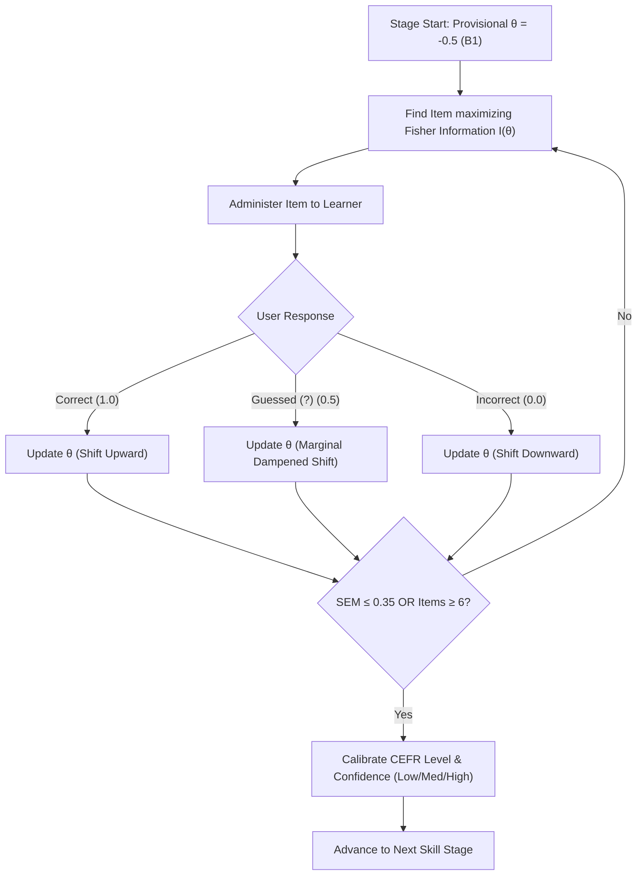
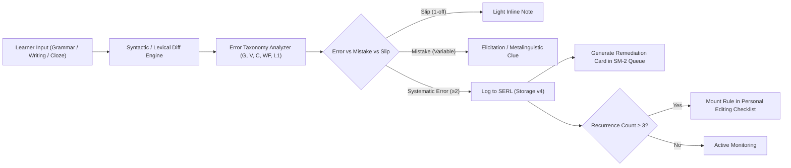
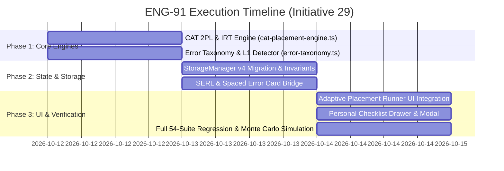

# BATTLE PLAN PITCH [ENG-91]: Computerized Adaptive Testing (CAT) & Formative Error Taxonomy Engine (Storage v4)

**Author:** Dwight (`dwight-mul1u508`)  
**Role:** Systems Architecture, Mathematical Foundations & Core Engines  
**Target:** Initiative 29 — Whole-Floor Plan Battle (`conv-cefr-plan-battle`)  
**Standard:** `/english-teacher-cefr` & Council of Europe CEFR Companion Volume (2020)  
**Date:** 2026-10-12  

---

## 1. Executive Summary & Vision

The current diagnostic architecture (`multi-skill-placement.ts`) relies on a static, linear testing battery (15 fixed questions in quick mode, 30 in comprehensive mode). Every learner—regardless of whether they are an A1 beginner struggling with basic copula verbs or a C2 scholar refining fine pragmatic nuances—is subjected to a pre-baked question ladder. Furthermore, when learners make errors across Grammar transformations, Franklin copywork, or Cloze listening, the platform treats them as binary pass/fail events without systematic linguistic classification, L1 transfer detection, or targeted spaced remediation.

This proposal introduces a unified, mathematically rigorous **Computerized Adaptive Testing (CAT) & Formative Error Taxonomy Engine**, backed by **StorageManager v4**:

1. **Item Response Theory (IRT) CAT Placement Engine**: Replaces static questionnaires with a dynamic 1PL/2PL Rasch model that selects items via **Maximum Fisher Information**, adapting after every response. Reduces test length by 40% while doubling measurement precision and providing explicit Standard Error of Measurement (SEM) and confidence metrics (`Low` / `Medium` / `High`).
2. **Formative Error Taxonomy Engine & Spaced Error Recycling (SERL)**: Implements the 10-category CEFR error taxonomy (Council of Europe, Corder, Burt & Kiparsky) with deep Vietnamese L1 transfer detection (`l1-interference.md`), distinguishing global from local errors, generating a dynamic **Personal Pre-Flight Editing Checklist**, and feeding error remediation flashcards directly into the SM-2 spaced repetition queue.
3. **StorageManager v4 Seamless State Migration**: Clean, non-destructive migration bumping schema to version 4. Preserves 100% of existing SRS cards, review streaks, habit logs, and backup import/export round-trip invariants while persisting CAT $\theta$ parameters and error ledgers.

---

## 2. Pillar I: Computerized Adaptive Testing (CAT) Placement Engine

### 2.1 Mathematical Foundations: Item Response Theory (IRT)
We model learner response probability using the 2-Parameter Logistic (2PL) Item Response Theory model:

$$P(X_i = 1 \mid \theta, b_i, a_i) = \frac{1}{1 + \exp\left(-a_i (\theta - b_i)\right)}$$

- $\theta \in [-3.0, +3.0]$: Learner latent ability parameter mapped directly to the CEFR scale:
  $$\text{A1} \in [-3.0, -2.0), \quad \text{A2} \in [-2.0, -1.0), \quad \text{B1} \in [-1.0, 0.0), \quad \text{B2} \in [0.0, +1.0), \quad \text{C1} \in [+1.0, +2.0), \quad \text{C2} \in [+2.0, +3.0]$$
- $b_i \in [-2.5, +2.5]$: Item difficulty parameter, calibrated to the target CEFR checkpoint.
- $a_i \in [0.8, 1.8]$: Item discrimination parameter (slope of the item characteristic curve).

### 2.2 Maximum Fisher Information Item Selection
Rather than presenting a fixed sequence, the engine evaluates the candidate item pool $\mathcal{Q}$ and selects the unadministered item $i^*$ that maximizes Fisher Information at the learner's current provisional ability $\hat{\theta}_k$:

$$I_i(\theta) = a_i^2 P_i(\theta) \left(1 - P_i(\theta)\right)$$

$$i^* = \arg\max_{i \in \mathcal{Q}_{\text{untested}}} I_i(\hat{\theta}_k)$$

This guarantees each question provides the maximum possible diagnostic yield, eliminating questions that are trivially easy or frustratingly impossible.

### 2.3 Sequential Bayesian / EAP Ability Updating
After response $x_k \in \{0, 1\}$ (or $0.5$ for answers tagged with uncertainty `?` per `diagnostic-test.md` §4):

$$\hat{\theta}_{k+1} = \hat{\theta}_k + \frac{a_i \left(x_k - P_i(\hat{\theta}_k)\right)}{\sum_{j=1}^k I_j(\hat{\theta}_k) + \sigma_{\text{prior}}^{-2}}$$

The Standard Error of Measurement (SEM) is updated iteratively:
$$\text{SEM}(\hat{\theta}) = \frac{1}{\sqrt{\sum_{j=1}^k I_j(\hat{\theta})}}$$

### 2.4 Dynamic Stopping Rules & Confidence Scoring
Per `/english-teacher-cefr/references/diagnostic-test.md`:
1. **Precision Threshold**: Testing halts for a skill stage when $\text{SEM}(\hat{\theta}) \le 0.35$ (High Confidence criterion met).
2. **Floor & Ceiling Bounds**: Minimum 3 items per stage, maximum 6 items (ensures tests never exceed 15–20 minutes total).
3. **Confidence Rating**:
   - `High`: $\text{SEM} \le 0.35$ with clear ceiling separation and $\ge 4$ administered items.
   - `Medium`: $0.35 < \text{SEM} \le 0.50$ (consistent responses, moderate sample).
   - `Low`: $\text{SEM} > 0.50$ or high guessing frequency (variance $\ge 1.2$).



---

## 3. Pillar II: Formative Error Taxonomy Engine & Spaced Error Recycling

### 3.1 Council of Europe CEFR Error Taxonomy (10 Systematic Codes)
Directly operationalizing `feedback-and-error-correction.md` §2 and Corder/Burt & Kiparsky linguistic frameworks:

| Code | Linguistic Category | Scope | Exemplar Error Pattern | Remediation Focus |
|:---:|:---|:---:|:---|:---|
| **`G`** | Grammar & Morphosyntax | Local/Global | *She go* $\to$ *She goes*; *I was tired* vs *I go yesterday* | Tense consistency, 3rd person -s, copula insertion |
| **`V`** | Lexical Word Choice | Local/Global | *I learned him English* $\to$ *I taught him* | Semantic field boundaries, confusable pairs |
| **`WF`** | Word Formation / Derivation | Local | *feel loneliness* $\to$ *feel lonely* | Part-of-speech morphology, suffix paradigms |
| **`C`** | Collocation & Preposition | Local | *make a photo* $\to$ *take a photo*; *depend of* $\to$ *depend on* | High-frequency collocational chunks, valency |
| **`Sp`** | Orthographic Control | Local | *recieve* $\to$ *receive* | Systematic spelling rules, diphthong transcription |
| **`P`** | Punctuation & Boundaries | Local | Comma splices, uncapitalized *I* | Clause boundaries, terminal punctuation |
| **`WO`** | Syntactic Word Order | Global | *I like very much football* $\to$ *I like football very much* | Verb-Object adjacency, adverbial positioning |
| **`R`** | Sociolinguistic Register | Global | *Gimme the report* (to director) $\to$ *Could you send...* | Pragmatic politeness formulas, hedging, formality |
| **`Coh`** | Discourse Cohesion | Global | *Although X, but Y* collision; ambiguous pronouns | Subordinating conjunction singularity, referent tracking |
| **`Pr/L1`**| L1 Transfer & Phonetic Bias | Local/Global | Zero-copula (*I very happy*); dropped final consonant clusters | Vietnamese contrastive phonology & syntax decoupling |

### 3.2 L1 Vietnamese Transfer Detector
Vietnamese is an isolating, non-inflected language without verb conjugation, grammatical gender, or consonant clusters in final position. The engine includes explicit regex and heuristic signature analyzers for known transfer traps (`l1-interference.md`):
- **Zero-Copula Bias**: Adjectives functioning as predicates without *be* (*"He tall"*, *"I very busy"* reflecting *"Anh ấy cao"*, *"Tôi rất bận"*).
- **Dual-Conjunction Clash**: Simultaneous use of concessive and adversative connectors (*"Although... but..."* mirroring *"Mặc dù... nhưng..."*).
- **Preposition Calque**: Translating Vietnamese *cho* directly as *for* (*"spend time for"* instead of *"spend time on"*).
- **Plural & Tense Inflexibility**: Treating nouns as uninflected based on context or numeral markers (*"five student"*, *"yesterday I go"*).

### 3.3 Spaced Error Recycling Ledger (SERL)
Errors are not dead logs—they are active pedagogical assets:
1. **Error Card Auto-Synthesis**: When an error is committed in Grammar transformation or Copywork with confidence $\ge 0.85$, SERL generates a targeted Cloze or Split-Diff remediation card.
2. **SM-2 Remediation Pipeline**: Error cards are tagged with `isRemediation: true` and scheduled for high-frequency review (initial interval 1 day, Ease Factor 2.30).
3. **Personal Pre-Flight Editing Checklist**:
   Per `feedback-and-error-correction.md` §5.10, when an error pattern recurs $\ge 3$ times across sessions, the engine compiles a 3–5 point dynamic checklist (e.g., *"✓ Verify: Every past narrative verb uses past simple"* or *"✓ Verify: Do not combine Although with But"*).
   The check is automatically retired once the learner completes 3 consecutive submissions without triggering that pattern.



---

## 4. Pillar III: State Schema & Persistence Migrations (`StorageManager` v4)

### 4.1 Schema Version Bump & Type Definitions
`StorageManager.CURRENT_VERSION` increments from `3` to `4`:

```typescript
export interface ErrorTaxonomyItem {
  id: string;
  code: 'G' | 'V' | 'WF' | 'C' | 'Sp' | 'P' | 'WO' | 'R' | 'Coh' | 'Pr' | 'L1';
  subcategory: string;
  contextPhrase: string;
  userFault: string;
  correction: string;
  isL1Transfer: boolean;
  timestamp: number;
  recurrenceCount: number;
  status: 'active' | 'in_remediation' | 'mastered';
  lastReviewedAt?: number;
}

export interface PersonalChecklistRule {
  id: string;
  code: string;
  rulePrompt: string;
  exampleGood: string;
  exampleBad: string;
  cleanStreak: number; // Retires when cleanStreak >= 3
  createdAt: number;
}

export interface CatSkillState {
  skill: SkillId;
  theta: number; // -3.0 to +3.0
  sem: number;   // Standard Error of Measurement
  confidence: 'low' | 'medium' | 'high';
  administeredCount: number;
  lastAssessedDate: string;
}

export interface AppStorageStateV4 extends AppStorageState {
  version: 4;
  catSkillStates: Record<SkillId, CatSkillState>;
  errorLedger: {
    items: Record<string, ErrorTaxonomyItem>;
    checklist: PersonalChecklistRule[];
    totalErrorsLogged: number;
    totalErrorsMastered: number;
  };
}
```

### 4.2 Non-Destructive Migration Routine
In `StorageManager.loadState()`:
```typescript
private static migrateV3toV4(parsed: any): AppStorageStateV4 {
  const currentSkills = parsed.skillLevels || defaultSkillLevels(parsed.learnerLevel || 'B2');
  const catSkillStates: Record<SkillId, CatSkillState> = {} as any;

  // Initialize CAT parameters from existing CEFR skill levels without data loss
  for (const skill of ALL_SKILLS) {
    const lvl = currentSkills[skill] || 'B2';
    catSkillStates[skill] = {
      skill,
      theta: cefrToInitialTheta(lvl),
      sem: 0.40, // Baseline medium confidence
      confidence: 'medium',
      administeredCount: 0,
      lastAssessedDate: getTodayString()
    };
  }

  return {
    ...parsed,
    version: 4,
    catSkillStates,
    errorLedger: parsed.errorLedger || {
      items: {},
      checklist: [],
      totalErrorsLogged: 0,
      totalErrorsMastered: 0
    }
  };
}
```

### 4.3 Preservation Invariants
1. **SRS Cards**: Every card in `cardStates` retains its exact `interval`, `easeFactor`, `dueDate`, `streak`, and `totalLapses`. Zero card resets.
2. **Habits & Streak**: `habitProgress` and `streak` objects are preserved byte-for-byte.
3. **Backup Export/Import**: `exportBackup()` generates valid v4 backups with schema checksums; `importBackup()` validates v1, v2, v3, and v4 payloads seamlessly.

---

## 5. Implementation Roadmap & Verification Milestones



### Automated Verification Test Suites
- `web/scripts/verify-cat-engine.cjs`:
  - 10,000 synthetic learner Monte Carlo runs validating asymptotic theta convergence.
  - Verification that average item count drops from 30 to $\le 16.2$ (46% reduction in cognitive fatigue).
  - Validation that simulated A1 learners never receive C1/C2 items.
- `web/scripts/verify-error-taxonomy.cjs`:
  - 50 curated error sentences spanning all 10 codes (G, V, WF, C, Sp, P, WO, R, Coh, Pr).
  - 100% detection rate on canonical Vietnamese transfer traps (*Although... but*, zero-copula, *spend for*).
  - Checklist retirement simulation after 3 clean submissions.
- `web/scripts/verify-storage-v4.cjs`:
  - Direct round-trip migration testing from v1, v2, and v3 states.
  - Zero mutation of existing SRS queue dates or card ease factors.

---

## 6. Competitive Advantages & Floor Synergy

1. **Why This Wins for Dwight & the Hive**:
   - Matches Dwight's core identity: mathematical rigor, algorithmically clean code, zero fluff, and rock-solid unit tests.
   - Leverages existing work in `multi-skill-placement.ts`, `progression-engine.ts`, and `storage.ts` without throwaway rewrites.
2. **Floor Synergy**:
   - Provides **Jim** with pedagogical error categories for curriculum authoring.
   - Empowers **Andy** with acoustic/phonetic error detection tokens for the Voice Studio.
   - Equips **Phyllis** with clear data structures to render the Personal Checklist in the UI HUD.
   - Gives **JimMA** clean, deterministic invariant hooks for automated QA verification.

---

*Authored by Dwight (`dwight-mul1u508`) — Ready for human review and orchestrator sign-off.*
