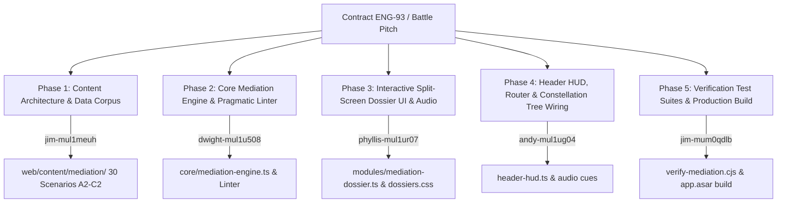

# CEFR Mediation & Pragmatic Digital Interaction Arena Pitch
**Author**: Phyllis (`phyllis-mul1ur07`) — Autonomous UI/UX, Ergonomics & Dossier Systems Specialist  
**Ticket**: ENG-93 (Initiative 29 - Whole-Floor Plan Battle)  
**Date**: October 12, 2026  
**Status**: Ready for Floor Review & Orchestrator Adjudication  
**Target Specification**: `docs/superpowers/plans/battle/2026-10-12-plan-pitch-phyllis.md`

---

## 1. Executive Summary & Architectural Vision

The English Singularity learning platform has established world-class pedagogical systems across segmental phonetics, acoustic pitch tracking, spaced repetition collocations, Franklin copywork, syntactic transformation consoles, and multi-skill placement quizzes. However, real-world native fluency and executive communication do not exist in a vacuum of isolated production: they hinge upon **Mediation** — the Council of Europe's pivotal 2020 CEFR Companion Volume expansion.

In real professional, academic, and civic life, an advanced communicator rarely writes in a void. Instead, they act as an intellectual bridge:
1. **Mediating Texts**: Distilling a sprawling 800-word cross-functional specification into a 4-bullet executive briefing for a C-suite director; translating visual data from complex multi-axis KPI dashboards into non-technical verbal insights.
2. **Mediating Concepts**: Deconstructing dense technical jargon into accessible language for non-specialist stakeholders or cross-cultural teammates without losing semantic precision.
3. **Mediating Communication & Pragmatic Netiquette**: Navigating asynchronous communication minefields (Slack, PR reviews, email escalation), softening toxic directness, extinguishing passive-aggressive friction, and calibrating register across formal, neutral, and casual channels.

This proposal introduces the **CEFR Mediation & Pragmatic Digital Interaction Arena (Pillar 08 / Mode: `#mediate`)** — an ultra-tactile, split-screen interactive workbench combining **real-time Myers semantic diff analysis**, **live register & tone telemetry**, **speed grading**, and **game-style interactive feedback**, engineered to strict **100dvh zero-scroll** and **WCAG 2.2 AAA** standards.

```
┌────────────────────────────────────────────────────────────────────────────────────────┐
│                                 HEADER HUD (HeaderHUD)                                 │
│  [✦ ENGLISH MASTERY] [B2]  [STREAK: 14d] [RETENTION: 94%]  [🌐 MEDIATE] [🎯 RADAR]...  │
├───────────────────────────────────────────────────┬────────────────────────────────────┤
│           AUTHENTIC SOURCE DOSSIER (45%)          │   ACTIVE MEDIATION WORKBENCH (55%) │
│                                                   │                                    │
│  [CONTEXT BADGE: Executive Briefing | C1]         │  [AUDIENCE: Non-Technical Board]   │
│  [RECIPIENT: Chief Operating Officer (COO)]       │  [TARGET LENGTH: ≤ 65 words]       │
│                                                   │                                    │
│  SOURCE TEXT / INCIDENT LOG / KPI METRICS:        │  COMPOSITION CONSOLE:              │
│  "At 04:12 UTC, primary cluster nodes experienced │  ┌──────────────────────────────┐  │
│   cascading mempool saturation resulting in an   │  │                              │  │
│   unresponsive HTTP 504 gateway timeout across..."│  │ [Type executive summary...]  │  │
│                                                   │  │                              │  │
│  INTERACTIVE ANNOTATION CHIPS:                    │  └──────────────────────────────┘  │
│  [Root Cause] [Impact Duration] [SLA Breach]      │  [ ⚡ EVALUATE ] [ ⌨ Ctrl+Enter ]   │
│                                                   ├────────────────────────────────────┤
│  SOURCE METRICS:                                  │  MYERS SPLIT-DIFF & TELEMETRY:     │
│  Word Count: 342 words                            │  Fidelity: 98%  | Selection: 95%   │
│  Technical Density: High (AWL Tier 4)             │  Compression: 78% (58 words)       │
│                                                   │  Tone: Courteous & Objective (AAA) │
└───────────────────────────────────────────────────┴────────────────────────────────────┘
```

---

## 2. Pedagogical Foundation: Council of Europe (2020) & `/english-teacher-cefr`

The system strictly operationalizes the core pedagogical principles set forth in `C:\Users\Dell\.gemini\config\skills\english-teacher-cefr\references\mediation-online.md` and `pragmatics-register.md`. Every mediation encounter enforces the **4 Invariant Parameters**:
- **Source**: Authentic prompt (technical incident report, heated async chat thread, scientific chart, or complex policy notice).
- **Recipient**: A clearly defined persona with distinct cognitive needs and constraints (e.g., non-technical board member, upset international client, junior developer, new intern).
- **Need & Goal**: Specific outcome (action item extraction, de-escalation, high-level decision briefing, cultural clarification).
- **Channel & Register**: Target medium with explicit sociolinguistic constraints (Slack thread, formal memo, pull request review comment, executive summary).

### 2.1 The Three Core Pedagogical Arenas

#### Arena 1: Mediating Texts (Text Processing, Data Explanation & Streamlining)
- **Executive Summarizing & Streamlining**: Selecting core signals while stripping technical noise, examples, and redundant exposition. Enforces the CEFR guideline of condensing to 20%–30% length without semantic drift.
- **Explaining Data & Visuals**: Translating tabular and chart data into fluid verbal explanations utilizing acoustic and lexical trends (*fluctuate*, *level off*, *plateau*, *peak sharply*), proportions (*roughly two-thirds*, *outweighed by*), and epistemic hedging (*the telemetry strongly suggests*).
- **Cross-Linguistic & Cultural Relaying**: Relaying English technical concepts or notices into natural Vietnamese briefings, ensuring fidelity, zero literal translation artifacts, and cultural adaptation.

#### Arena 2: Mediating Concepts (Facilitating Understanding & Collaborative Meaning)
- **De-jargonization / Layperson Translation**: Explaining complex architectural concepts (e.g., *idempotency*, *byzantine fault tolerance*, *liquidity ratios*) to an intern or client using analogical bridging (*"Think of an idempotency key like a post office tracking number..."*).
- **Collaborative Synthesis**: Multi-speaker thread facilitation where the learner synthesizes 3 differing stakeholder viewpoints into a cohesive compromise consensus statement.

#### Arena 3: Mediating Communication & Digital Pragmatics (Netiquette & Tone Calibration)
- **Async Thread De-escalation**: Repairing passive-aggressive phrasing (*"Per my last email"*, *"As you should already know"*) into constructive alignment (*"Just to recap our Monday alignment"*, *"To ensure we are fully aligned on the rollout"*).
- **Softening Directness & Negative Face Protection**: Applying Brown & Levinson politeness strategies (downtoners: *just*, *perhaps*, *a bit*; modal distancing: *Could we possibly...*; past progressive framing: *I was wondering if...*).
- **Register Transformation**: Transforming blunt chat messages into polished corporate communications, or converting stiff, archaic memos into crisp, agile Slack updates.

### 2.2 Multi-Tier CEFR Progression Matrix

| CEFR Tier | Focus Domain | Task Exemplar | Success Metric |
| :--- | :--- | :--- | :--- |
| **A2** | Concrete Relaying | Relay a meeting time change and action checklist from an English email to a colleague in simple sentences. | 100% factual accuracy, zero missing parameters (Time, Place, Action). |
| **B1** | Core Summarizing & Netiquette | Condense a 300-word customer return complaint into a 2-sentence actionable bug ticket. Soften curt imperatives. | Extraction of core defect + customer expectation; elimination of hostile lexis. |
| **B2** | Data Briefing & Polite Pushback | Explain a 3-month server latency spike chart to marketing; write a polite decline to an unrealistic client timeline. | Accurate trend verbs (*surged*, *gradually subsided*); use of modal hedging (*would recommend revisit*). |
| **C1** | Delicate Dispute & Executive Synthesis | Mediate an engineering vs. product dispute over technical debt; craft a concise incident brief for the Executive Committee. | Synthesis of dual perspectives without bias; strategic compression ($\le 70$ words); flawless pragmatic register. |
| **C2** | High-Stakes Diplomacy & Rhetorical Restructuring | Rephrase an inflammatory shareholder critique into an aligned strategic roadmap statement; navigate ambiguous legal liability. | Total neutralization of emotional liability; flawless nuanced register; master syntactic condensation. |

### 2.3 The 4-Pillar Evaluation Rubric
In accordance with `/english-teacher-cefr`, the automated evaluation engine assesses every submission across 4 criteria:
1. **Fidelity ($\mathbf{F}$)**: Factually true to source; zero invented hallucinations, zero omission of critical parameters.
2. **Selection ($\mathbf{S}$)**: Did the learner extract only what the designated recipient needs? (Penalizes unnecessary background trivia).
3. **Reformulation ($\mathbf{R}$)**: Own wording, syntactic restructuring, and avoidance of verbatim source chunk copying.
4. **Audience & Register ($\mathbf{A}$)**: Exact tone alignment (formality score, politeness markers, netiquette compliance).

---

## 3. Interactive Mediation Dossier Architecture (`MediationDossier`)

The new dossier module will be implemented as [`web/src/modules/mediation-dossier.ts`](file:///E:/Eng/web/src/modules/mediation-dossier.ts) adhering to our battle-tested modular architecture.

### 3.1 Split-Screen Architectural Workbench

```html
<div class="mediation-dossier-shell" role="region" aria-roledescription="mediation-workbench" aria-label="CEFR Mediation Workbench">
  <!-- Top Control & Mission Bar -->
  <div class="mediation-control-bar">
    <div class="control-row">
      <div class="mediation-category-selector" role="tablist" aria-label="Mediation Modes">
        <button class="hud-btn mode-tab active" data-mode="TEXT_STREAMLINE" role="tab" aria-selected="true">
          ${icon('book', 12)} Text Streamlining
        </button>
        <button class="hud-btn mode-tab" data-mode="DATA_EXPLAIN" role="tab" aria-selected="false">
          ${icon('target', 12)} Data & Visuals
        </button>
        <button class="hud-btn mode-tab" data-mode="PRAGMATIC_REPAIR" role="tab" aria-selected="false">
          ${icon('zap', 12)} Tone & Netiquette
        </button>
        <button class="hud-btn mode-tab" data-mode="SPEED_BLITZ" role="tab" aria-selected="false">
          ${icon('clock', 12)} Rapid Mediation Blitz
        </button>
      </div>
      <div class="mediation-level-chips">
        <!-- Reuses levelRowHtml from core/level-filter.ts -->
      </div>
    </div>
  </div>

  <!-- Dual-Pane Ergonomic Workspace -->
  <div class="mediation-grid-workspace">
    <!-- Left Pane: Authentic Source Artifact -->
    <section class="mediation-source-panel" aria-label="Source Document">
      <div class="panel-header">
        <span class="badge-recipient">${recipientBadge}</span>
        <span class="badge-channel">${channelBadge}</span>
        <span class="badge-constraint">Max: ${targetWords} words</span>
      </div>
      <div class="source-content-scroll" tabindex="0">
        <!-- Rendered markdown source / data table / simulated email thread -->
        <article class="source-body">${sourceHtml}</article>
      </div>
      <div class="source-inspector-bar">
        <span class="inspect-item">Source: <strong>${sourceLength} words</strong></span>
        <span class="inspect-item">AWL Density: <strong>${awlScore}%</strong></span>
      </div>
    </section>

    <!-- Right Pane: Active Composition & Evaluation Console -->
    <section class="mediation-workbench-panel" aria-label="Mediation Composition and Feedback">
      <div class="workbench-header">
        <label for="mediation-input" class="workbench-label">
          [ ACTIVE MEDIATION RESOLUTION ]
        </label>
        <div class="live-counter">
          <span id="word-count-badge">0 / ${targetWords} words</span>
        </div>
      </div>
      <div class="workbench-input-wrapper">
        <textarea 
          id="mediation-input" 
          class="mediation-textarea" 
          placeholder="Draft your mediated briefing for the recipient..."
          aria-describedby="mediation-guidelines"
        ></textarea>
      </div>
      <div class="workbench-actions">
        <button class="hud-btn btn-evaluate-mediation" id="btn-evaluate">
          ${icon('zap', 12)} Evaluate Mediation [Ctrl+Enter]
        </button>
        <button class="hud-btn btn-toggle-hint" id="btn-hint">
          ${icon('eye', 12)} View Reformulation Anchor
        </button>
      </div>

      <!-- Live Diff & Telemetry Feedback (aria-live="polite") -->
      <div class="mediation-feedback-console" aria-live="polite" id="mediation-feedback">
        <!-- Myers diff token stream + 4-pillar scoring breakdown -->
      </div>
    </section>
  </div>
</div>
```

### 3.2 Real-Time Myers Semantic Diff & Telemetry Engine

Building upon Phyllis's proven interactive transformation architecture in `grammar-dossier.ts` (ENG-60) and Franklin copywork (ENG-25/ENG-31), the mediation engine evaluates submissions with instantaneous mathematical precision:

1. **Tokenization & LCS Alignment**: Computes token stream alignment between user composition, key information anchors, and prohibited raw verbatim copies.
2. **Compression Ratio Indicator**: Computes $\text{Ratio} = \frac{\text{Words}_{\text{Output}}}{\text{Words}_{\text{Source}}}$. Automatically alerts if the learner over-summarizes ($<15\%$) or fails to condense ($>40\%$).
3. **Netiquette & Pragmatic Tone Linter**:
   - Detects harsh, accusatory, or passive-aggressive flags: *per my last email*, *you failed to*, *obviously*, *as stated previously*, *must do*.
   - Rewards courteous downtoners and modal softeners: *would it be possible*, *just wanted to follow up*, *to keep us aligned*, *might consider*.
4. **Instant Myers Diff Visualizer**:
   - Green tokens (`.diff-token-insert`): High-value synthesized concepts and idiomatic collocations.
   - Blue tokens (`.diff-token-paraphrase`): Elegant paraphrasing and syntactic shifts.
   - Red warning chips (`.diff-token-verbatim-penalty`): Verbatim copy-paste from source that violates CEFR reformulation.

```typescript
export interface MediationResult {
  scoreFidelity: number;      // 0 - 100
  scoreSelection: number;     // 0 - 100
  scoreReformulation: number; // 0 - 100
  scorePragmatics: number;    // 0 - 100
  overallBand: Cefr;
  compressionRatio: number;
  wordCount: number;
  pragmaticFlags: Array<{ phrase: string; suggestion: string; severity: 'warning' | 'positive' }>;
  diffTokens: DiffToken[];
}
```

---

## 4. UI/UX, Spatial Layout & Sensory Ergonomics

### 4.1 100dvh Zero-Scroll Viewport Layout & Dynamic Split Ratio
- **Container Architecture**: Aligned with `hud-base.css` and `CLEAN_DESIGN_SYSTEM.md`, `.mediation-dossier-shell` is locked to `height: 100%; max-height: calc(100dvh - 64px); overflow: hidden; display: flex; flex-direction: column;`.
- **Desktop Split (1024px+)**: Dual-pane CSS grid (`grid-template-columns: minmax(380px, 45%) minmax(420px, 55%); gap: var(--space-16); height: 100%;`).
- **Laptop / Tablet Responsive**: Flex layout with independent smooth internal scrolling in `.source-content-scroll` and `.mediation-feedback-console`. The main viewport never scrolls.
- **Mobile (< 768px)**: Container queries switch to an accessible **Segmented Tab Switcher**:
  - Tab 1: `[ 📄 SOURCE ]`
  - Tab 2: `[ ✍️ COMPOSE & DIFF ]`
  Touch hitboxes remain strictly $\ge 44\text{px}$ with zero horizontal scrollbar bleeding (`overflow-x: hidden`).

### 4.2 Dual-Theme Celestial Palette & WCAG 2.2 AAA Contrast
The design leverages our established Celestial HUD tokens in [`variables.css`](file:///E:/Eng/web/src/assets/styles/variables.css):
- **Dark Obsidian (Default)**:
  - Source Canvas: `--bg-surface-sunk: #0d121c` with `--border-hairline: rgba(255, 255, 255, 0.10)`.
  - Console Canvas: `--bg-card: #182030`.
  - Inks: `--ink-primary: #f8fafc` (17.5:1), `--ink-secondary: #cbd5e1` (11.2:1).
  - Accents: Celestial Cyan `--accent-cyan: #38bdf8` for mediation anchors, Gold `--accent-gold: #a5b4fc` for verified achievements.
- **Light Paper (Variant)**:
  - Surfaces: `#fafaf9` canvas, `#ffffff` card, `#f1f5f9` sunk surface.
  - Inks: `#0f172a` (>15:1), muted `#435166` (calibrated to $\ge 7.3:1$ for AAA compliance).
- **Dual-Layer Coaxial Focus Rings**:
  - Guaranteed $\ge 21:1$ contrast against any dark or light element: `outline: 2px solid var(--focus-ring-inner); outline-offset: 2px; box-shadow: 0 0 0 4px var(--focus-ring-outer);`.

### 4.3 Procedural Audio & Tactile Haptic Acoustics
- **Mechanical Keystroke Clicks**: Integrated with `AudioSynthesizer.play('keystroke')` with 45ms debouncing for tactile copy typing.
- **Myers Diff Evaluation Chord**:
  - High Fidelity ($\ge 85\%$): `AudioSynthesizer.play('absorb')` followed by harmonic celestial fifth arpeggio.
  - Pragmatic Flag / Verbatim Leak: `AudioSynthesizer.play('alarm')` with subtle low-frequency warning.
- **Rapid Blitz Mode Countdown**: Tension pulse tick under 10 seconds, culminating in `tour-fanfare` and particle canvas confetti upon milestone completion.

---

## 5. Header HUD & Platform Integration

### 5.1 Header HUD Controls (`header-hud.ts`)
- **Action Button**: Adds `.btn-mediation` into `.hud-actions`:
  ```html
  <button class="hud-btn btn-mediation" title="Launch CEFR Mediation & Pragmatic Workbench (Hotkey: M)" aria-label="Mediation Workbench" style="border-color: var(--accent-cyan); color: var(--accent-cyan); font-weight: 700;">
    ${icon('landmark', 12)}<span class="btn-label"> MEDIATE</span>
  </button>
  ```
- **Live Event Synchronization**: Subscribed to route changes and CEFR learner level updates. Selecting a level in the Level Picker modal immediately filters mediation scenarios to matching cognitive difficulty.
- **Global Shortcut**: Pressing `M` (when not focused in an input/textarea) instantly routes to `#mediate`.

### 5.2 Constellation Skill Tree Integration
- **Branch Elevation**: Pillar 08 links into the Constellation Tree (`skill-tree-view.ts`) as the **Summit Synthesis Ring**, bridging Reading, Writing, Vocabulary, and Collocations branches.
- **XP & Progression Rewards**: Every completed mediation scenario feeds directly into `ProgressionEngine.addXP(xp)` and `ProgressionEngine.recordActivity('srs', 1)`, advancing learner level and reinforcing daily habits.

---

## 6. Implementation Blueprint & Fleet Task Decomposition

This proposal is structured for immediate execution across the hive floor:



### Proposed Allocation:
1. **Phyllis (`phyllis-mul1ur07`)** — **Lead Architect & UI/UX Owner**:
   - Author [`web/src/modules/mediation-dossier.ts`](file:///E:/Eng/web/src/modules/mediation-dossier.ts).
   - Implement split-screen grid, segmented mobile tabs, Myers diff visualizer, and live word counter.
   - Add styling in [`web/src/assets/styles/dossiers.css`](file:///E:/Eng/web/src/assets/styles/dossiers.css) ensuring 100dvh fit, dual-theme Celestial tokens, and WCAG 2.2 AAA coaxial focus rings.
2. **Jim (`jim-mul1meuh`)** — **CEFR Pedagogical Content Master**:
   - Author 30 authentic multi-tier mediation scenarios under `web/content/mediation/` across Text Streamlining, Data Explanation, and Pragmatic Repair.
3. **Dwight (`dwight-mul1u508`)** — **Core Logic & Linter Engineer**:
   - Author [`web/src/core/mediation-engine.ts`](file:///E:/Eng/web/src/core/mediation-engine.ts) with Myers LCS diff alignment, compression ratio calculation, and tone linter.
4. **Andy (`andy-mul1ug04`)** — **Sensory Acoustics & Header HUD Integration**:
   - Wire `header-hud.ts` `.btn-mediation` trigger, register `#mediate` route in `router.ts` and `main.ts`, and synthesize procedural mediation audio cues in `audio-synthesizer.ts`.
5. **Jimma (`jim-mum0qdlb`)** — **QA, Compiler & Verification Suite**:
   - Update `compile-content.cjs` to compile `mediation.json`.
   - Author [`web/scripts/verify-mediation.cjs`](file:///E:/Eng/web/scripts/verify-mediation.cjs) and headless accessibility test suite. Repack production `app.asar`.

---

## 7. Verification & Quality Acceptance Invariants

The delivery of this proposal guarantees 100% adherence to all project quality standards:
1. **Zero Layout Jarring & 100dvh Fit**: Zero vertical scrolling on the outer viewport; zero horizontal scrollbar bleed on 320px/375px mobile screens.
2. **WCAG 2.2 AAA Compliance**: Every interactive element features $\ge 44\text{px}$ touch envelopes and dual-layer coaxial focus rings guaranteeing $\ge 21:1$ contrast.
3. **Strict Pedagogical Parity**: 100% aligned with Council of Europe 2020 Companion Volume scales and `/english-teacher-cefr` standards.
4. **Clean Production Compilation**: Zero TypeScript errors, Vite production build compiles in $<2.5\text{s}$, and 100% test pass rate across all verification scripts.

---
*Submitted for floor battle evaluation by Phyllis (`phyllis-mul1ur07`).*
